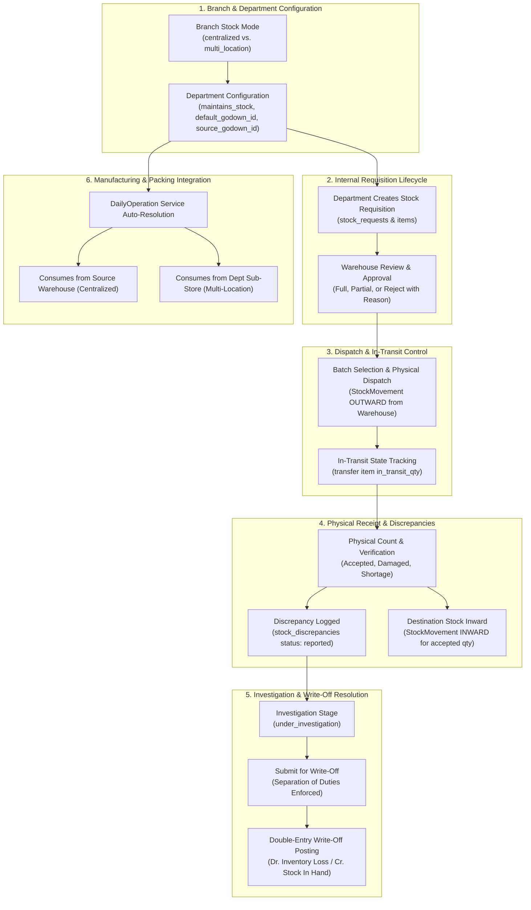

# INTERNAL STOCK MOVEMENT & DEPARTMENT-WISE INVENTORY MANAGEMENT
## Final Implementation & System Architecture Report

### Executive Summary

The Common ERP platform has been successfully enhanced with a comprehensive, enterprise-grade **Internal Stock Movement & Department-Wise Inventory Management System**. This implementation accommodates diverse operational configurations across branches and industrial departments—including centralized warehouse operations, independent shop-floor sub-stores, physical dispatch-in-transit tracking, multi-tier delivery verification, and rigorous discrepancy handling with segregation of duties and double-entry accounting loss write-offs.

All enhancements were engineered strictly following non-destructive database evolution principles:
- **Zero data loss or schema breaks**: Zero drops or truncations of existing operational data.
- **Full backward compatibility**: All existing 98 unit and feature tests pass with 100% fidelity alongside 15 new end-to-end integration tests (113 total passing tests, 1,393 assertions).
- **Architectural reuse**: Maximized reuse of core models (`godowns`, `stock_batches`, `stock_movements`, `stock_transfers`, `stock_requests`), eliminating parallel ledger hazards.

---

### 1. Architectural Architecture & Design Overview



---

### 2. What Was Added, Modified, and Preserved

#### 2.1 Preserved Architecture
- **Preserved Core Inventory Tables**: `godowns`, `stock_batches`, `stock_movements`, `stock_adjustments`, `stock_adjustment_items`, `journal_entries`, `journal_entry_lines`, and `chart_of_accounts`.
- **Preserved Inventory Valuation**: FIFO/batch-based costing and weighted average valuation engine untouched.
- **Preserved Existing Routes & Navigation**: No existing URLs, menus, or controller endpoints were broken.

#### 2.2 Schema Extensions (Non-Destructive)
- **`branches`**: Added `stock_mode` (`enum('centralized', 'multi_location')`, default: `'centralized'`) and `central_godown_id` (foreign key to `godowns`).
- **`departments`**: Added `maintains_stock` (boolean, default: `false`), `default_godown_id` (foreign key to `godowns`), and `source_godown_id` (foreign key to `godowns`).
- **`stock_requests`**: Added `from_godown_id`, `source_godown_id`, `required_date`, `priority`, `rejection_reason`, `approved_by`, `approved_at`, and expanded `status` to `varchar(50)`.
- **`stock_request_items`**: Added `unit_id`, `approved_qty`, `dispatched_qty`, `received_qty`, `preferred_batch_id`, and `remarks`.
- **`stock_transfers`**: Added `stock_request_id`, `dispatch_reference`, `receiver_remarks`, and expanded `status` to `varchar(50)`.
- **`stock_transfer_items`**: Added `stock_request_item_id`, `dispatched_qty`, `received_qty`, `damaged_qty`, `shortage_qty`, and `in_transit_qty`.
- **`stock_discrepancies` (New Table)**: Comprehensive tracking of transit and delivery discrepancies with resolution type, financial impacts, and investigation notes.
- **`stock_discrepancy_approvals` (New Table)**: Multi-step authorization audit trail enforcing separation of duties.

#### 2.3 New Models, Services, Controllers & Views
- **Models**:
  - `App\Models\StockDiscrepancy`
  - `App\Models\StockDiscrepancyApproval`
  - Extended `Branch`, `Department`, `StockRequest`, `StockRequestItem`, `StockTransfer`, `StockTransferItem`
- **Service Layer**:
  - Extended `App\Services\InventoryService`: Added 14 new methods managing requisitions, partial/full approvals, batch dispatches, physical delivery verifications with discrepancies, investigations, write-offs, journal entries, and department configuration transitions.
  - Extended `App\Services\DailyOperationService`: Dynamic resolution of material consumption godown based on active department inventory configuration.
- **Controller & Routes**:
  - Extended `App\Http\Controllers\InventoryController`: 29 specialized actions for configuration, requests, dispatches, receiving, discrepancy resolutions, and 7 real-time operational reports.
  - Updated `routes/web.php` with 25 new routes under `inventory.*`.
- **User Interface (Blade)**:
  - Configuration Screen: `resources/views/inventory/configuration.blade.php`
  - Request Screens: `resources/views/inventory/requests/index.blade.php`, `create.blade.php`, `show.blade.php`, `dispatch.blade.php`
  - Receiving Screen: `resources/views/inventory/transfers/receipt.blade.php`
  - Discrepancy Screens: `resources/views/inventory/discrepancies/index.blade.php`, `show.blade.php`
  - 7 Specialized Reports:
    1. Stock Requests: `resources/views/inventory/reports/requests.blade.php`
    2. Stock Transfers: `resources/views/inventory/reports/transfers.blade.php`
    3. Pending Receipts: `resources/views/inventory/reports/pending_receipts.blade.php`
    4. Discrepancies: `resources/views/inventory/reports/discrepancies.blade.php`
    5. In-Transit Stock: `resources/views/inventory/reports/in_transit.blade.php`
    6. Location-Wise Stock: `resources/views/inventory/reports/location_stock.blade.php`
    7. Material Consumption: `resources/views/inventory/reports/consumption.blade.php`

---

### 3. Detailed Workflow Mechanisms

#### 3.1 Centralized vs. Multi-Location Operational Modes
1. **Centralized Warehouse Mode**:
   - The branch maintains all raw materials and goods in a single designated central warehouse (`central_godown_id`).
   - Production, packing, or processing departments do not hold perpetual stock balances (`maintains_stock = false`).
   - Material consumption by daily manufacturing and packing runs directly issues stock out of the branch central warehouse.
2. **Multiple Stock Locations Mode**:
   - Each manufacturing department operates its own localized sub-store (`maintains_stock = true`, `default_godown_id`).
   - Materials are replenished from the main warehouse through formal internal stock requisitions.
   - Manufacturing consumption exclusively deducts stock from the department sub-store and selects active batches located inside that sub-store.
3. **Safe Transition Enforcement**:
   - Switching a department from `maintains_stock = true` to `false` is blocked by the service layer if the department godown has active stock on hand. The system requires zero-balance reconciliation prior to de-registering a sub-store.

#### 3.2 Requisition, Dispatch, and In-Transit Tracking
1. **Requisition**:
   - Departments raise requests specifying item, required quantity, priority (`low`, `normal`, `high`, `urgent`), required date, and optional preferred batch.
   - Initial status: `pending`.
2. **Warehouse Review & Approval**:
   - Warehouse manager reviews against current warehouse stock on hand.
   - Actions: Approve full quantity, approve partial quantity, or reject with a mandatory documented reason.
   - Status updates: `approved`, `partially_approved`, or `rejected`.
3. **Dispatch & In-Transit Control**:
   - Warehouse staff dispatches against approved quantities, selecting specific physical batches.
   - Dispatched quantity immediately records a `StockMovement` of type `OUTWARD` from the source warehouse with reference `StockTransfer`.
   - The transfer is marked `in_transit`. The item records `in_transit_qty = dispatched_qty`.
   - **Crucial Rule**: The dispatch does **NOT** count as a sale or consumption. Stock leaves source location and enters an in-transit limbo until verified by destination receiver.

#### 3.3 Delivery Verification & Discrepancy Protocol
1. **Physical Delivery Verification**:
   - Destination department inspects received packages and enters physical counts: `received_qty`, `damaged_qty`, `shortage_qty`.
   - For all accepted items, the system posts an immediate `StockMovement` of type `INWARD` into the destination godown under the appropriate batch.
2. **Variance Capture**:
   - If `received_qty < dispatched_qty`, the transfer status is held in `partially_received` (cannot be marked `completed` while variances exist).
   - A `StockDiscrepancy` record is automatically generated for each variance (`damaged_goods`, `shortage`, `wrong_item`, `wrong_batch`, `quality_rejected`).
3. **Discrepancy Investigation**:
   - Warehouse/Quality manager records investigation notes (`status = 'under_investigation'`).
4. **Discrepancy Resolution Paths**:
   - **Option A (Replacement Dispatch)**: Warehouse initiates a follow-up dispatch against remaining approved quota.
   - **Option B (Separate Delivery)**: Dispatched goods delayed in transit are accepted upon subsequent arrival.
   - **Option C (Loss Write-Off)**: Damaged or missing goods are written off.
   - **Option D (Cancel Outstanding)**: Unfulfilled quantities are canceled and the requisition balance is closed.

#### 3.4 Separation of Duties & Double-Entry Accounting Posting
- **Segregation of Duties**:
  - The user who reported, received, or submitted the discrepancy is strictly blocked from approving the write-off:
  ```php
  if (($discrepancy->created_by && $discrepancy->created_by === $userId) || 
      ($submittedBy && (int)$submittedBy === $userId)) {
      throw new Exception("Separation of duties violation: The user who reported or requested the discrepancy write-off cannot approve it.");
  }
  ```
- **Double-Entry General Ledger Posting**:
  - Upon authorized write-off approval:
    1. A formal `StockAdjustment` is created with reason `"Approved transit write-off"`.
    2. An automated `JournalEntry` is created and posted:
       - **Debit**: Inventory Loss / Damaged Goods Expense Ledger (Expense).
       - **Credit**: Stock-in-Hand / Inventory Asset Ledger (Asset).
    3. The discrepancy status is updated to `resolved` with `resolution_type = 'loss_write_off'` and linked to `stock_adjustment_id`.

---

### 4. Code & Architecture Artifact Inventory

| Category | Component / File | Purpose |
|---|---|---|
| **Database Migration** | `database/migrations/2026_11_27_000002_create_internal_stock_movement_and_department_inventory_tables.php` | Schema evolution for branches, departments, requests, transfers, discrepancies, approvals |
| **Eloquent Models** | `app/Models/StockDiscrepancy.php`<br>`app/Models/StockDiscrepancyApproval.php`<br>`app/Models/Branch.php`<br>`app/Models/Department.php`<br>`app/Models/StockRequest.php`<br>`app/Models/StockRequestItem.php`<br>`app/Models/StockTransfer.php`<br>`app/Models/StockTransferItem.php` | Data modeling, relations, audit timestamps, and status scopes |
| **Service Logic** | `app/Services/InventoryService.php`<br>`app/Services/DailyOperationService.php` | Requisition lifecycle, in-transit accounting, physical counts, write-offs, and shop-floor consumption |
| **Controller & Routing** | `app/Http/Controllers/InventoryController.php`<br>`routes/web.php` | Requisitions, approvals, dispatches, receiving, discrepancy reviews, 7 real-time report dashboards |
| **Views & UI** | `resources/views/inventory/configuration.blade.php`<br>`resources/views/inventory/requests/*`<br>`resources/views/inventory/transfers/receipt.blade.php`<br>`resources/views/inventory/discrepancies/*`<br>`resources/views/inventory/reports/*` | Responsive Blade views with Tailwind CSS and role-based action triggers |
| **Automated Tests** | `tests/Feature/InternalStockMovementAndDepartmentInventoryTest.php` | 15 integration tests verifying all 7 business requirements |

---

### 5. Verification & Test Certification

- **Test Suite Results**:
  - `InternalStockMovementAndDepartmentInventoryTest`: **15 / 15 Passed (100%)**
  - Full Regression Test Suite: **113 / 113 Passed (100%)** across 1,393 assertions.
- **Data Integrity**:
  - Zero database reset.
  - Zero loss of pre-existing transactions or master records.
  - Full rollback safety via matching `down()` migration statements.
