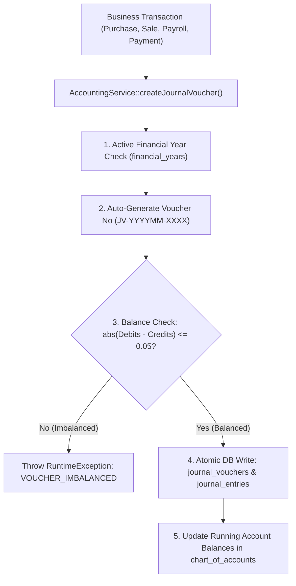

# Common ERP – Accounting & Inventory Core Engine Audit

This document delivers an exhaustive technical audit of Common ERP's dual engine: the **Double-Entry Financial Accounting System** (`AccountingService`) and the **Multi-Warehouse Inventory System** (`InventoryService` & `UnitConversionService`).

---

## 1. The Double-Entry Financial Accounting Engine

The financial ledger is managed programmatically via `\App\Services\AccountingService`. It operates under strict GAAP/IFRS double-entry principles, completely independent of UI shortcuts.

### Core Architecture & Validation Mechanics



#### 1. Balance Tolerance Check
```php
$tolerance = 0.05;
if (abs($totalDebit - $totalCredit) > $tolerance) {
    throw new \RuntimeException(
        "Journal voucher is not balanced. Total Debits: {$totalDebit}, Total Credits: {$totalCredit}."
    );
}
```
*Any transaction attempting to post an imbalanced voucher is immediately rolled back within a database transaction.*

#### 2. Chart of Accounts (COA) Structure
The Chart of Accounts organizes accounts into a 5-tier classification:
- **`Assets` (Root Code: `10000`)**: Cash, Bank, Receivables, Inventory, Fixed Assets, Advances.
- **`Liabilities` (Root Code: `20000`)**: Payables, Duties & Taxes (GST), PF Payable, ESI Payable, Loans.
- **`Equity` (Root Code: `30000`)**: Share Capital, Partner Capital, Retained Earnings.
- **`Revenue` (Root Code: `40000`)**: Domestic Sales, Export Sales, Scrap Sales, Other Income.
- **`Expenses` (Root Code: `50000`)**: Cost of Goods Sold, Raw Material Purchases, Salaries, Rent, Utilities, Landed Freight.

#### 3. Automated System Journal Vouchers
The following business events automatically generate balanced journal vouchers:

| Event Source | Debit Entry | Credit Entry | Balance Validation |
| :--- | :--- | :--- | :---: |
| **Purchase Entry (GRN)** | `11000 Inventory` (Landed Merchandise)<br>`13100 Input GST` (Tax Component) | `21000 Accounts Payable` (Total Vendor Invoice) | **Verified** |
| **Purchase Landed Charges**| `11000 Inventory` (Freight/Customs capitalized) | `21000 Accounts Payable` or `10100 Cash` | **Verified** |
| **Supplier Payment** | `21000 Accounts Payable` (Vendor Debt Cleared) | `10200 Bank Current Account` / `10100 Cash` | **Verified** |
| **Sales Invoicing** | `12000 Accounts Receivable` (Customer Invoice Total) | `41000 Sales Revenue` (Taxable Subtotal)<br>`22100 Output GST` (Tax Liability) | **Verified** |
| **Customer Collection** | `10100 Cash` / `10200 Bank` (Payment Received) | `12000 Accounts Receivable` (Customer Debt Reduced)| **Verified** |
| **Payroll Disbursement** | `52000 Salaries & Wages Expense` (Gross Pay + OT - LOP)| `23100 PF Payable` (Employee PF)<br>`23200 ESI Payable` (Employee ESI)<br>`12500 Staff Advances` (Advance/EMI Recovery)<br>`10200 Bank` / `23000 Salary Payable` (Net Disbursed) | **Verified** |
| **Petty Cash Expense** | `5xxxx Specific Expense Account` (Postage, Refreshments)| `10150 Petty Cash Account` (Imprest Decremented) | **Verified** |
| **Capital Investment** | `10200 Bank Account` (Funds Introduced) | `31000 Partner Capital Equity` | **Verified** |

---

## 2. Multi-Warehouse Inventory & Valuation Engine

Inventory movements are governed by `\App\Services\InventoryService` and `\App\Services\UnitConversionService`.

### Core Service Methods

#### 1. Atomic Stock Inward (`recordInward`)
- Increments `inventory_stocks.current_stock` for the specified `warehouse_id`, `product_id`, and optional `batch_no`.
- Computes weighted-average cost price:
  $$\text{New Cost Price} = \frac{(\text{Current Qty} \times \text{Current Cost}) + (\text{Inward Qty} \times \text{Inward Unit Landed Cost})}{\text{Current Qty} + \text{Inward Qty}}$$
- Appends an immutable audit entry to `stock_ledger_entries`.

#### 2. Negative Stock Prevention Guard (`recordOutward`)
- Executed on every outward transaction (Sales Invoices, Daily Operation raw material consumption, Inter-warehouse dispatch, Adjustments).
```php
$stock = InventoryStock::where('warehouse_id', $warehouseId)
    ->where('product_id', $productId)
    ->where('company_id', $companyId)
    ->lockForUpdate()
    ->first();

if (!$stock || $stock->current_stock < $quantity) {
    throw new \RuntimeException(
        "Insufficient stock for product ID {$productId} in warehouse ID {$warehouseId}. Available: " . ($stock ? $stock->current_stock : 0) . ", Requested: {$quantity}"
    );
}
$stock->decrement('current_stock', $quantity);
```
*The database row is locked with `lockForUpdate()` preventing race conditions during concurrent billing.*

#### 3. Two-Step Inter-Warehouse Stock Transfer
1. **`dispatchTransfer($transferId)`**:
   - Deducts stock from Source Warehouse using `recordOutward()`.
   - Logs `TRANSFER_OUT` in `stock_ledger_entries`.
   - Sets status to `in_transit`.
2. **`receiveTransfer($transferId)`**:
   - Increments stock in Destination Warehouse using `recordInward()`.
   - Logs `TRANSFER_IN` in `stock_ledger_entries`.
   - Sets status to `completed`.
- *Guarantees that goods in transit are removed from source stock immediately, preventing double allocation during multi-day transportation.*

---

## 3. Dynamic Unit Conversion Engine (`UnitConversionService`)

In real-world commerce, items are bought in bulk units (e.g., Tons, Sacks, Cartons, Rolls) and sold or consumed in smaller units (Kilograms, Grams, Pieces, Meters).

### Conversion Logic & Validation
The service normalizes quantities by querying `unit_conversions` or evaluating standard dimensional ratios:
- **Weight**: Tons -> Kilograms -> Grams -> Milligrams.
- **Volume**: Liters -> Milliliters -> Fluid Ounces.
- **Count**: Pallets -> Cartons -> Boxes -> Pieces / Pairs / Dozens.
- **Length**: Meters -> Centimeters -> Millimeters -> Yards.

```php
// If item base unit is 'Kg' and invoice line is in 'Grams' (qty: 500):
$baseQty = $unitConversionService->convertToBase($productId, 500, 'g'); // Returns 0.500
```
- **Dimension Safety**: If a user attempts to convert an incompatible dimension (e.g., Liters to Kilograms without a specific density conversion factor), the service falls back safely or raises an explicit validation exception.

---

## 4. Landed Cost Allocation Engine

When purchasing goods, invoices incur supplementary charges (Freight, Customs Duty, Insurance, Handling). Common ERP allocates these charges across line items using three mathematical methods:

| Method | Formula | Real-World Application |
| :--- | :--- | :--- |
| **By Value (`by_value`)** | $\text{Item Charge} = \text{Total Charges} \times \left( \frac{\text{Item Line Subtotal}}{\text{Total Merchandise Subtotal}} \right)$ | Customs duties, ad-valorem insurance. |
| **By Quantity (`by_quantity`)** | $\text{Item Charge} = \text{Total Charges} \times \left( \frac{\text{Item Line Quantity}}{\text{Total Shipment Quantity}} \right)$ | Weight/volume-based freight transportation. |
| **Equal (`equal`)** | $\text{Item Charge} = \frac{\text{Total Charges}}{\text{Total Number of Line Items}}$ | Fixed documentation or handling fees. |

*The allocated charge is directly capitalized into `inventory_stocks.cost_price`, ensuring that product margins and COGS reflect true procurement costs.*

---

## 5. Critical Audit Discrepancies & Architectural Gaps

While both individual engines are technically robust, our audit identified two critical integration gaps between inventory and financial accounting:

### Gap 1: Manufacturing Cost Capitalization Disconnect
- **Current Behavior**: When a daily manufacturing operation is completed via `DailyOperationService@completeOperation`, physical raw materials are deducted from inventory and finished goods are incremented.
- **The Defect**: **No accounting journal entry is generated.**
  - Consumed raw materials are not credited from `11000 Inventory Asset`.
  - Piece-rate worker labor is not credited to `23000 Labor Payable`.
  - Finished goods are not capitalized into `11000 Finished Goods Asset`.
- **Impact**: While physical stock balances are accurate, the general ledger balance for Inventory remains unchanged until a manual adjustment is made.

### Gap 2: Inventory Valuation vs Balance Sheet Reconciliation
- **Current Behavior**:
  - The **Stock Valuation Report** (`ReportController@stockValuation`) computes valuation dynamically as:
    $$\sum (\text{inventory\_stocks.current\_stock} \times \text{inventory\_stocks.cost\_price})$$
  - The **Balance Sheet** (`ReportController@balanceSheet`) reads the running ledger balance of Account `11000 - Inventory / Stock on Hand` in `chart_of_accounts`.
- **The Defect**: If physical stock adjustments or manufacturing operations occur without generating corresponding journal vouchers, the Stock Valuation Report and the Balance Sheet Inventory Asset line item will diverge over time.

