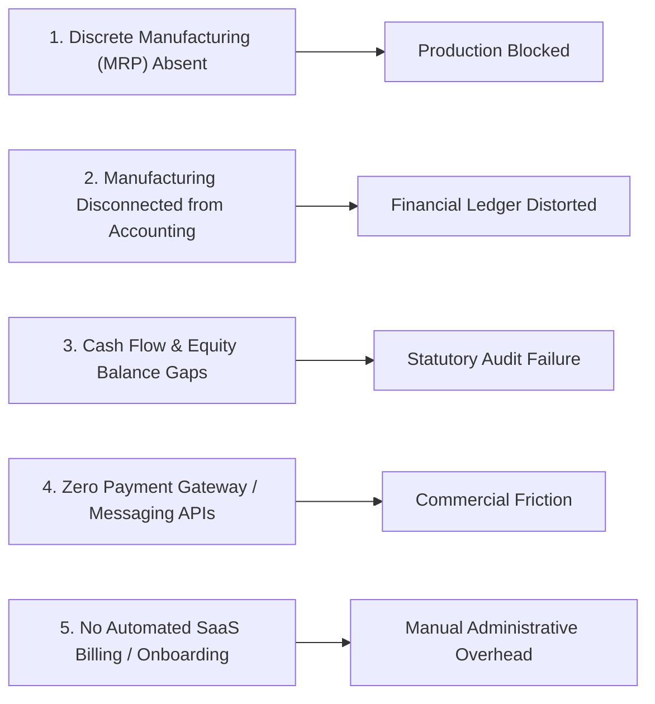

# Common ERP – Commercial Readiness & Enterprise Viability Audit

## 1. Executive Summary & Commercial Rating

Common ERP currently represents an **advanced functional operational prototype / managed pilot ERP**. Its core transactional engines—multi-company isolation, double-entry financial ledgering, negative stock prevention, multi-unit conversions, and payroll processing—are genuine, mathematically verified, and operational.

However, to transition from an internal pilot to a **commercial SaaS product or off-the-shelf enterprise solution**, the application must satisfy rigorous commercial, compliance, operational, and integration requirements.

### Commercial Readiness Score
$$\mathbf{64\% \ / \ 100\%}$$
- **Status**: **NOT READY FOR UNMANAGED SAAS / PUBLIC COMMERCIAL SALE**.
- **Suitable For**: **Controlled, single-tenant or managed-service pilot deployments** where an IT administrator manages database backups, configuration, and user onboarding.

---

## 2. Evaluation Across Twenty (20) Commercial Dimensions

| # | Commercial Dimension | Score (1-5) | Implementation Status | Current Capabilities | Critical Commercial Gaps |
| :--- | :--- | :---: | :--- | :--- | :--- |
| **1** | **Multi-Currency Accounting** | **2 / 5** | Partially Implemented | Currency symbol/code set per company; transactions recorded in company base currency. | No daily exchange rate feed; no realized/unrealized foreign exchange gain/loss ledger calculation. |
| **2** | **Multi-Branch & Warehouse** | **5 / 5** | Implemented & Verified | Multiple branches and warehouses per company; 2-step inter-warehouse stock transfer with transit state. | Complete. Fully operational. |
| **3** | **Tax Compliance Engine (GST)** | **4 / 5** | Implemented & Verified | Tax rates per product, CGST/SGST/IGST breakdown on sales/purchases, tax registers. | No automated TDS/TCS deduction engine on payments or high-value sales. |
| **4** | **RBAC & Segregation of Duties** | **4 / 5** | Implemented & Verified | Granular permissions matrix, `CheckPermission` middleware, role assignments per company. | No dual-authorization (maker-checker) approval flow for high-value payments or JV postings. |
| **5** | **Audit Trails & Tamper Logs** | **2 / 5** | Backend Only / UI Missing | Database table `audit_logs` exists with old/new values. | No user-facing UI to view audit trails; not all controller actions write to audit table. |
| **6** | **Document Printing (PDF/Thermal)**| **4 / 5** | Implemented & Verified | Dedicated Blade PDF views for Sales Invoices (`invoice_pdf`) and Payslips (`slip_pdf`), POS print layout. | Thermal POS printing relies on browser print dialog; no ESC/POS raw hardware printer driver. |
| **7** | **Data Export (Excel/CSV)** | **3 / 5** | Partially Implemented | CSV export for Daily Operations and specific financial reports. | Missing universal "Export to Excel/PDF" across all data grids and master listings. |
| **8** | **Data Backup & Disaster Recovery** | **2 / 5** | Script / CLI Dependent | MySQL standard dump scripts operable via artisan CLI. | No automated in-app scheduled backup, no one-click tenant database export, no automated S3 upload. |
| **9** | **Payment Gateway Integration** | **1 / 5** | Not Implemented | Cash, Bank, Cheque payment recording only. | Zero payment gateway integration (no Razorpay, Cashfree, Stripe, or dynamic UPI QR codes). |
| **10**| **Automated Messaging (SMS/WA)** | **1 / 5** | Not Implemented | None. | No SMS or WhatsApp Cloud API integration for automated invoice/payment dispatch to customers. |
| **11**| **E-Invoicing & E-Way Bill** | **1 / 5** | Not Implemented | None. | No integration with Indian NIC / GST portal API for automated IRN generation or E-Way Bill JSON generation. |
| **12**| **Mobile & PWA Experience** | **3 / 5** | Partially Implemented | Responsive Bootstrap 5 layout renders on tablet and mobile browser viewports. | No offline PWA service worker; dense tabular data grids require extensive horizontal scrolling on mobile. |
| **13**| **POS Resiliency & Offline Mode** | **2 / 5** | UI Only / Online Required | Fast POS counter billing view with keyboard shortcuts. | Completely dependent on live server connection; zero offline IndexedDB caching if network drops. |
| **14**| **Performance Under Concurrency** | **4 / 5** | Implemented & Verified | `lockForUpdate()` on inventory rows prevents negative stock race conditions; indexed keys. | No Redis caching layer configured for heavy dashboard reporting queries. |
| **15**| **Security & Penetration Hardening**| **5 / 5** | Implemented & Verified | 15/15 passing tenant isolation tests, CSRF protection, password hashing (Bcrypt), SQL injection protection. | High security posture. No known cross-tenant vulnerabilities. |
| **16**| **Customer Support & Knowledgebase**| **1 / 5** | Not Implemented | None. | No contextual in-app user guide, tooltips, or support ticket helpdesk. |
| **17**| **Extensibility & Open API** | **1 / 5** | Not Implemented | Default Laravel Sanctum `/api/user` route only. | No public REST/GraphQL API endpoints for ERP integration with Shopify, WooCommerce, or external WMS. |
| **18**| **SaaS Subscription & Billing** | **1 / 5** | Not Implemented | Admin can manually create companies and users. | No automated tenant self-signup, no Stripe/Paddle subscription billing, no tier-based feature gating. |
| **19**| **Fiscal Year Locking & Closing** | **3 / 5** | Partially Implemented | Financial year records maintain `is_locked` flag; transactions validate against fiscal dates. | No automated year-end closing wizard to roll forward balances and zero out nominal revenue/expense accounts. |
| **20**| **Data Privacy & Compliance (DPDP)**| **3 / 5** | Partially Implemented | Multi-tenant isolation protects commercial data; user authentication enforced. | No GDPR/DPDP "Right to be Forgotten" data erasure tool, no automated PII data anonymization. |

---

## 3. The Top 5 Critical Commercial Showstoppers

Before this application can be offered to paying commercial clients, five critical deficiencies must be resolved:

1. **MRP & BOM Modules Missing from UI**:
   - Discrete manufacturing enterprises cannot use the ERP to plan material requirements or track bills of material because `boms` and `production_orders` lack UI views and controllers.
2. **Manufacturing Cost Disconnected from Financial Ledger**:
   - The manufacturing engine consumes physical materials and logs labor without generating double-entry journal vouchers to capitalize costs into Work-in-Progress (WIP) or Finished Goods.
3. **Statutory Financial Reporting Incomplete**:
   - The absence of a Cash Flow Statement and dynamic Profit & Loss closing into Equity prevents businesses from passing formal statutory audits without manual external accounting interventions.
4. **Lack of Automated Customer-Facing Integrations**:
   - Modern retail and wholesale businesses require automated invoice emailing, WhatsApp dispatch, and dynamic UPI QR code generation on counter bills.
5. **Absence of Self-Service SaaS Architecture**:
   - Onboarding a new customer currently requires manual database administrator intervention to seed companies, chart of accounts, and fiscal years.

---

## 4. Commercialization Viability Strategy

### Recommended Commercial Deployment Modes

#### Phase 1: Managed On-Premise / Private Cloud Deployments (Viable Today)
- Deploy Common ERP as a managed dedicated instance for single SME enterprises (e.g. Malabar Foods or Manakkattu Enterprises).
- Dedicated technical team manages backups, fiscal year rollovers, and database maintenance.
- **Feasibility: HIGH**.

#### Phase 2: Public Multi-Tenant SaaS Platform (Requires 6–9 Months Engineering)
- Build self-service tenant onboarding with Stripe/Razorpay subscription billing.
- Implement Global Eloquent `TenantScope` across all models.
- Build missing REST API gateway for mobile apps and third-party e-commerce connectors.
- Implement manufacturing cost capitalization accounting and dynamic financial reporting closing.
- **Feasibility: CONDITIONAL UPON ROADMAP EXECUTION**.

