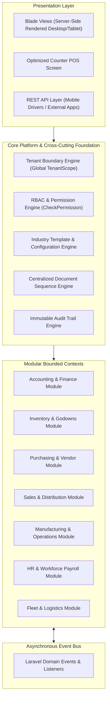
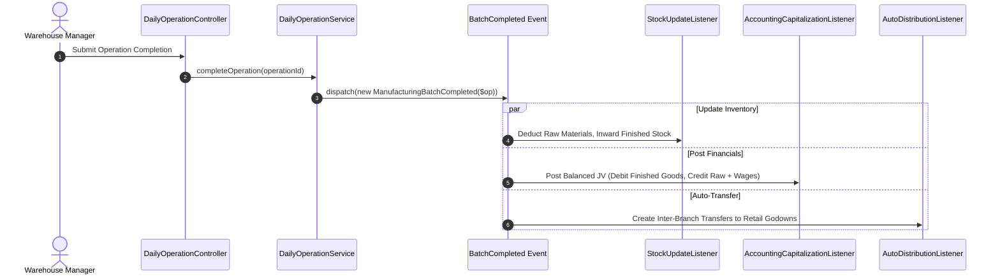
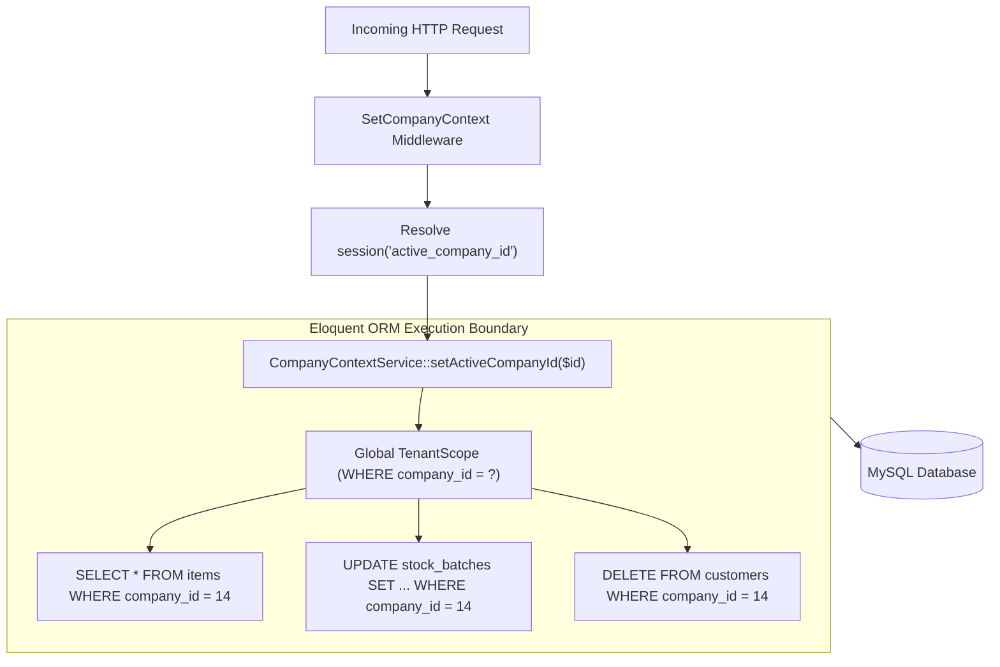

# Common ERP – Target Architecture Blueprint: The Unified Multi-Industry Platform

This document defines the official target architecture for Common ERP. It establishes how the current monolithic codebase will evolve into a clean, highly maintainable, and configurable **Modular Monolith** supporting multiple industries without code duplication or fragmented forks.

---

## 1. Architectural Philosophy: The Modular Monolith

Rather than fragmenting into independent industry codebases or introducing the operational overhead of microservices, Common ERP adopts a **Modular Monolith architecture**.



### Core Architecture Rules
1. **One Unified Codebase**: A single Git repository services all industries. No customer-specific or industry-specific branches.
2. **Domain Encapsulation**: Controllers must not contain raw accounting calculations or direct inventory mutations. Controllers delegate to Action classes or Domain Services.
3. **Event-Driven Decoupling**: Downstream side-effects (ledger journal posting, customer SMS/email notifications, inter-warehouse replenishment) are triggered via **Laravel Domain Events** rather than tightly coupled procedural calls.
4. **Separate Database per Customer**: For commercial deployment, each paying enterprise client receives an independent database instance, providing 100% physical data isolation, dedicated backup retention, and zero risk of cross-customer data leakage.

---

## 2. Target Domain Structure & Bounded Contexts

The application code will be organized into structured functional domains:

```
app/
├── Domains/
│   ├── Core/                     # Companies, Branches, Settings, Configuration, Setup Wizard
│   ├── Security/                 # Authentication, RBAC, Permissions, TenantScope
│   ├── MasterData/               # Categories, Units, Items, Customers, Suppliers, Routes
│   ├── Accounting/               # Ledgers, JournalEntries, FiscalYears, Reports, Banking, Capital
│   │   ├── Services/             # AccountingService, FinancialStatementService
│   │   ├── Actions/              # CreateJournalEntryAction, ReconcileBankAction
│   │   └── Listeners/            # PostPurchaseJournalListener, PostSalesJournalListener
│   ├── Inventory/                # Godowns, StockBatches, Movements, Transfers, Adjustments
│   │   ├── Services/             # InventoryService, UnitConversionService
│   │   └── Actions/              # RecordInwardAction, RecordOutwardAction, TransferStockAction
│   ├── Purchasing/               # Requests, Orders, Inward Entries, Landed Charges, Payments
│   ├── Sales/                    # Quotations, Orders, Invoices, POS, Deliveries, Collections
│   ├── Manufacturing/            # Daily Operations, BOMs, Production Orders, Quality Inspections
│   │   ├── Services/             # ManufacturingService, ProcessTemplateService
│   │   └── Listeners/            # CapitalizeManufacturingCostsListener
│   ├── HR/                       # Staff, Attendance, Overtime, Loans, Advances, Payroll Engine
│   └── Logistics/                # Fleet Vehicles, Drivers, Delivery Trips, Proof-of-Delivery
```

---

## 3. Event-Driven Integration Pattern

Currently, controllers procedurally invoke inventory deductions and journal voucher postings sequentially. If the accounting call fails, manual exception handling is required. The target architecture replaces this with **Domain Events**:



### Key Domain Events & Dedicated Listeners
| Domain Event | Primary Producer | Subscribed Listeners | Target Architectural Outcome |
| :--- | :--- | :--- | :--- |
| `PurchaseEntryRecorded` | `PurchaseController` | `UpdateStockInward`<br>`PostPurchaseJournalEntry`<br>`NotifySupplier` | Decouples stock inward, landed freight capitalization, and vendor AP ledgering. |
| `SalesInvoiceFinalized` | `SalesController` | `DeductStockOutward`<br>`PostSalesJournalEntry`<br>`SendInvoiceEmailPdf` | Deducts stock atomically, posts revenue/tax JV, and emails printable PDF to customer. |
| `ManufacturingBatchCompleted` | `DailyOperationService` | `ProcessStockMovements`<br>`PostManufacturingCostJournal`<br>`ExecuteBranchDistributions` | **Fixes P0 Gap:** Automatically capitalizes consumed raw materials and worker labor into inventory asset ledger. |
| `StockAdjustmentApproved` | `InventoryController` | `UpdateBatchBalance`<br>`PostStockWriteOffJournal` | **Fixes P0 Gap:** Automatically posts inventory shrinkage/loss journal voucher. |
| `PayrollPeriodProcessed` | `PayrollController` | `GenerateEmployeeSlips`<br>`PostSalaryDisbursementJournal` | Generates payslips and creates salary payable and statutory liability ledgers. |

---

## 4. Configuration Engine & Industry Template Schema

The target configuration engine eliminates hardcoded industry branching by introducing declarative JSON schemas stored in `industry_process_templates`:

### JSON Template Structure
```json
{
  "industry_code": "FOOD_PROCESSING",
  "industry_name": "Food & Spice Manufacturing",
  "enabled_modules": ["master", "purchase", "inventory", "daily_operations", "sales", "accounts", "payroll", "fleet"],
  "disabled_modules": ["boms", "service_billing"],
  "custom_fields": {
    "items": [
      {"name": "fssai_license", "type": "string", "label": "FSSAI License No", "required": false},
      {"name": "preservative_type", "type": "string", "label": "Preservatives", "required": false}
    ]
  },
  "default_ledgers": [
    {"code": "11010", "name": "Raw Materials - Whole Spices", "nature": "Assets"},
    {"code": "11020", "name": "Finished Goods - Curry Powders", "nature": "Assets"},
    {"code": "52050", "name": "Factory Roasting Wages", "nature": "Expenses"}
  ],
  "manufacturing_rules": {
    "enforce_batch": true,
    "enforce_expiry": true,
    "allow_scrap": true,
    "default_scrap_percentage": 5.0,
    "auto_distribution": true
  }
}
```

---

## 5. Security & Multi-Tenancy Architecture



### The Three Defensive Pillars
1. **Physical Customer Database Separation**: In commercial managed deployment, Customer A and Customer B reside on distinct MySQL databases.
2. **Global Eloquent `TenantScope`**: Within a customer's database, all multi-company queries are scoped automatically at the model level via `BelongsToTenant` trait. Developer error cannot leak data across internal companies.
3. **Route Model Binding Ownership Guards**: Controllers verify single-record ownership before rendering or executing actions, aborting with HTTP `403 Forbidden` on mismatch.
