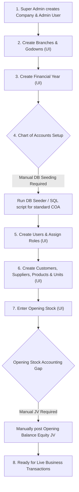

# Common ERP – Company Onboarding & Customer Deployment Validation

This document delivers a step-by-step trace and feasibility assessment of onboarding a new commercial entity into Common ERP, followed by a technical assessment of multi-customer deployment models.

---

## 1. Onboarding Trace: "Demo Trading Company"

To evaluate the onboarding user journey, we trace the 15 required operational setup steps for establishing a new trading business named **"Demo Trading Company"**.

Each step is classified strictly into one of five implementation availability tiers:
1. `AVAILABLE IN STANDARD UI`: Accessible to standard company administrators via browser screens.
2. `RESTRICTED ADMINISTRATIVE UI`: Accessible only to Super-Administrators via global management screens.
3. `MANUAL DATABASE INTERVENTION`: Requires developer/DBA execution of SQL queries, migrations, or artisan tinker commands.
4. `PARTIALLY IMPLEMENTED`: UI or backend exists, but critical workflow steps or validations are incomplete.
5. `NOT IMPLEMENTED`: Completely absent from UI, API, and backend code.

---

### Step-by-Step Onboarding Evaluation Matrix

| Step # | Onboarding Setup Step | Availability Tier | Route & Controller | Database Tables Touched | Audit Analysis & Operational Findings |
| :---: | :--- | :--- | :--- | :--- | :--- |
| **1** | **Register / Create Company** | `RESTRICTED ADMINISTRATIVE UI` | `GET /companies/create` `POST /companies` (`CompanyController@store`) | `companies`, `users` | Only accessible when logged in as a Super Admin. Captures company name, email, phone, address, tax number (GSTIN), and currency code. Automatically creates an initial administrator user. |
| **2** | **Configure Company Information** | `RESTRICTED ADMINISTRATIVE UI` | `GET /companies/{id}/edit` `PUT /companies/{id}` | `companies` | Super Admin can edit legal address, contact numbers, and fiscal preferences. Standard users cannot edit their own company profile. |
| **3** | **Select Business / Industry Type** | `PARTIALLY IMPLEMENTED` | Embedded in `CompanyController@store` | `companies.business_type` | Form provides an industry dropdown (Food Processing, Garments, Beverages, Retail, etc.). **Finding:** Selecting an industry merely saves a string to `companies.business_type`. It does **not** dynamically provision industry-specific modules, chart of accounts, or customized UI fields. |
| **4** | **Create Financial Year** | `AVAILABLE IN STANDARD UI` | `GET /accounts/financial-years` `POST /accounts/financial-years` (`AccountsController@financialYearStore`) | `financial_years` | Company admin defines start date (e.g. 2024-04-01), end date (e.g. 2025-03-31), code (e.g. `FY24-25`), and active flag. Essential for journal entry posting. |
| **5** | **Configure Chart of Accounts / Ledgers** | `MANUAL DATABASE INTERVENTION` (Initial Seeding) `AVAILABLE IN STANDARD UI` (Manual additions) | `GET /accounts/ledgers` `POST /accounts/ledgers` (`AccountsController@ledgerStore`) | `account_groups`, `ledgers` | **Critical Defect:** When a new company is created via the UI, the standard 44 chart of accounts ledgers are **NOT automatically seeded**. An admin must manually create dozens of ledgers one-by-one or a developer must run a backend seeder script. |
| **6** | **Create Branches** | `AVAILABLE IN STANDARD UI` | `POST /companies/{id}/branches` (`CompanyController@branchStore`) | `branches` | Admin can add multiple branches (Head Office, Retail Branch, Depot) with name, code, phone, address. |
| **7** | **Create Godowns / Warehouses** | `AVAILABLE IN STANDARD UI` | `GET /master/godowns` `POST /master/godowns` (`MasterDataController@godownStore`) | `godowns` | Captures godown name, code, associated branch ID, address, and storage type (Finished Goods, Raw Materials, Retail Shelf). |
| **8** | **Create Users** | `AVAILABLE IN STANDARD UI` | `GET /settings/users` `POST /settings/users` (`SettingsController@userStore`) | `users`, `user_company_branches` | Company admin creates user profiles with name, email, password, and links them to specific branches within the active company. |
| **9** | **Assign Roles & Permissions** | `AVAILABLE IN STANDARD UI` | `GET /settings/roles` `POST /settings/roles/{id}/update` (`SettingsController@roleUpdate`) | `roles`, `permissions`, `role_permissions` | Granular permission assignment per role across sales, purchases, inventory, accounts, and staff modules. |
| **10** | **Configure Company Settings** | `PARTIALLY IMPLEMENTED` | `GET /settings` `POST /settings` (`SettingsController@update`) | `system_settings` | Basic key-value pairs (invoice prefix, default tax rate). Does not support custom document sequences or approval limit thresholds. |
| **11** | **Create Customers & Suppliers** | `AVAILABLE IN STANDARD UI` | `GET /master/customers` `POST /master/customers` `GET /master/suppliers` `POST /master/suppliers` | `customers`, `suppliers`, `ledgers` | Creates partner profiles with GSTIN, billing address, credit limit, and terms. Automatically provisions corresponding Debtors/Creditors ledger accounts. |
| **12** | **Create Products & Units** | `AVAILABLE IN STANDARD UI` | `GET /master/units` `GET /master/products` `POST /master/products` | `units`, `categories`, `subcategories`, `items` | Defines units (Kg, Pcs, Box), categories, SKU, HSN code, tax slab, purchase cost, and selling price. |
| **13** | **Enter Opening Stock** | `PARTIALLY IMPLEMENTED` | `GET /inventory/opening-stock` `POST /inventory/opening-stock` (`InventoryController@openingStockStore`) | `stock_batches`, `stock_movements` | **Defect:** Allows bulk entry of opening quantities and unit costs into godowns. However, it updates only physical stock—**it posts zero accounting journal entries to the Inventory Asset / Opening Equity ledger**. |
| **14** | **Configure Required Modules** | `PARTIALLY IMPLEMENTED` | `company_modules` table | `company_modules` | Migration exists for `company_modules` (`company_id`, `module_name`, `is_enabled`). Middleware `CheckModuleEnabled` exists. However, there is **no UI screen** for an admin to toggle modules on or off; requires manual DB editing. |
| **15** | **Start Normal Operations** | `AVAILABLE IN STANDARD UI` | Core operational routes | Core transactional tables | Once master data, ledgers, and fiscal years exist, users can create Purchase Orders, Invoices, POS bills, and Staff Attendance. |

---

## 2. Onboarding Workflow Summary & Friction Points

### The Three Critical Onboarding Blockers
1. **Missing Automated COA Provisioning**: A non-technical business owner cannot simply click "Create Company" and start invoicing. Without manual database execution of `CompanyAccountsSeeder` or manual creation of 40+ ledgers, all invoicing and purchase operations fail because the system cannot find required nominal accounts (e.g., `Sales Revenue`, `Input GST`, `Accounts Payable`).
2. **Missing Module Activation UI**: Businesses cannot customize their menu or disable irrelevant modules (e.g. a pure retail shop cannot turn off Manufacturing or Fleet routes from the UI).
3. **Opening Stock Accounting Disconnect**: Entering opening inventory creates physical stock in godowns but does not capitalize inventory value into the general ledger.

---

## 3. Customer-Level Deployment Assessment

The user's defined business strategy mandates:
- **Managed deployment** for initial release.
- **Separate application installation and separate database per customer.**
- Preservation of internal multi-company and multi-branch functionality within a customer's installation.

### Independent Customer Architecture Evaluation

| Customer Requirement | Current Architectural Capability | Missing Operational & Deployment Capabilities |
| :--- | :--- | :--- |
| **Separate Application Installation** | **Capable.** Monolithic Laravel codebase can be cloned into independent virtual hosts (e.g. `/var/www/customer_a` and `/var/www/customer_b`). | No automated provisioning script (e.g., Ansible, Docker Compose, or Terraform) to spin up a new virtual host, configure Nginx, and generate unique app keys. |
| **Separate Database per Customer** | **Capable.** `.env` configuration binds each installation to its own MySQL database (e.g., `erp_cust_malabar`, `erp_cust_craftline`). | No tenant migration runner or master database provisioning tool. |
| **Independent Configuration** | **Capable.** Each customer instance maintains its own `.env` file for mail servers, storage paths, and app credentials. | Configuration changes currently require manual file editing via SSH or terminal. |
| **Independent Users & Permissions** | **Capable.** Users, passwords, and permissions reside exclusively within the customer's isolated database. | Cross-customer user federation is neither needed nor supported. |
| **Independent Files & Storage** | **Partially Capable.** Local storage (`storage/app/public`) resides on the local filesystem. | If multiple instances share a single physical server, disk quotas, isolation permissions, and storage cleanup must be configured at the OS level. |
| **Independent Backups & Recovery** | **Manual Only.** Database dumps must be executed via manual `mysqldump` commands per database. | No scheduled in-app backup mechanism, no automated cloud export (S3), and no one-click restore UI. |
| **Independent Application Updates** | **Manual Git Pull.** Updating an installation requires manual Git pulls, running migrations, and clearing caches. | Risk of breaking customer installations during updates without a staging pipeline or zero-downtime deployment script. |
| **Independent Logging & Monitoring**| **Standard Laravel Logs.** Logs write to `storage/logs/laravel.log` per installation. | No centralized error aggregation (e.g., Sentry, Bugsnag) or uptime monitoring across customer instances. |

---

## 4. Recommendations for Managed Deployment Automation

To deliver a reliable, repeatable managed deployment experience without building an expensive multi-tenant SaaS control plane:

1. **Build a Company Setup Wizard (`/install` or `/setup`)**:
   - When a fresh database is connected, prompt the administrator with a 5-step wizard:
     1. Company Profile & Tax Identifiers.
     2. Industry Vertical Selection (e.g. Spice Manufacturing, Boutique Retail, Hardware).
     3. Automated Chart of Accounts generation tailored to that industry.
     4. Default Branch & Godown creation.
     5. Financial Year initialization.
2. **Standardize Docker / Docker Compose Deployment Blueprints**:
   - Create a clean `docker-compose.yml` defining an isolated PHP-FPM, Nginx, and MySQL container stack per paying customer.
   - Enables 5-minute automated customer provisioning and total database/file isolation.
3. **Automate Nightly Database Dumps**:
   - Install and configure `spatie/laravel-backup` in each customer instance to automatically dump the database nightly, compress it, encrypt it, and upload it to an isolated customer folder on Amazon S3 or Wasabi cloud storage.
