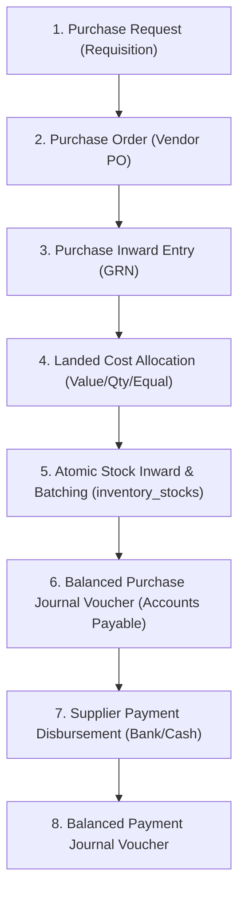
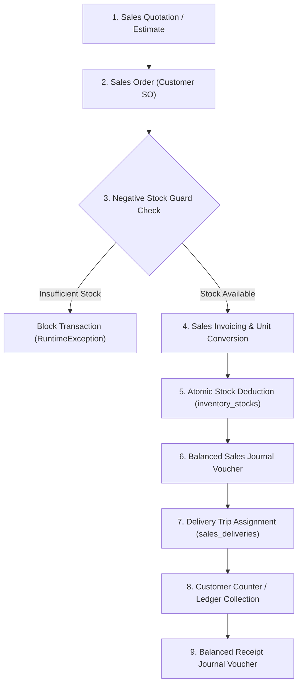
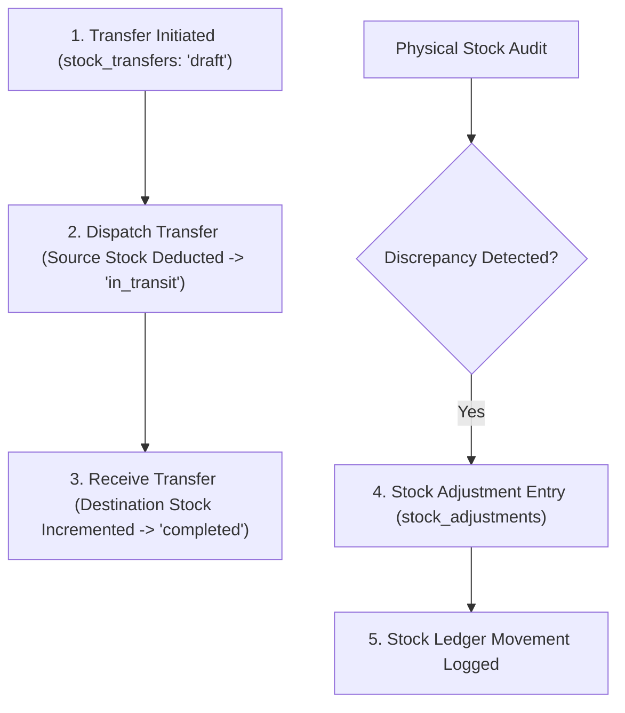
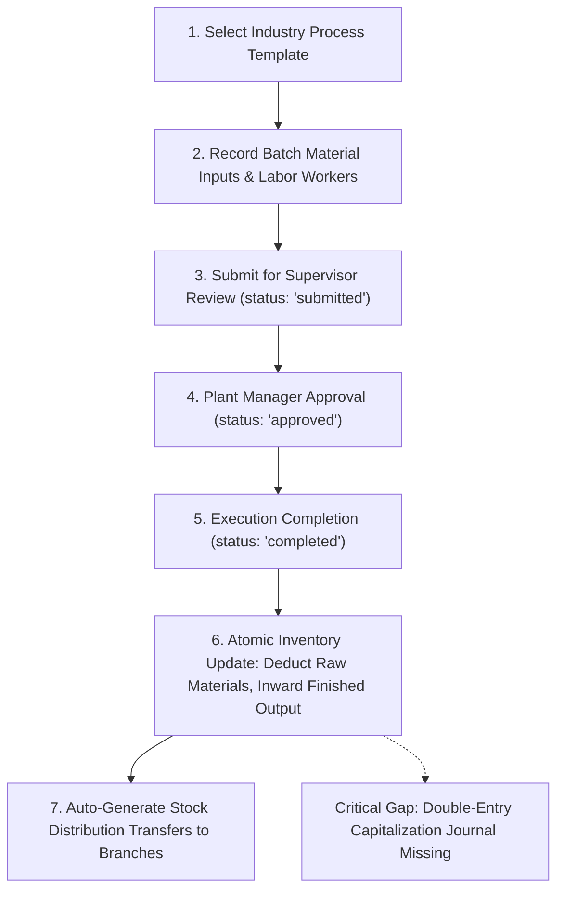
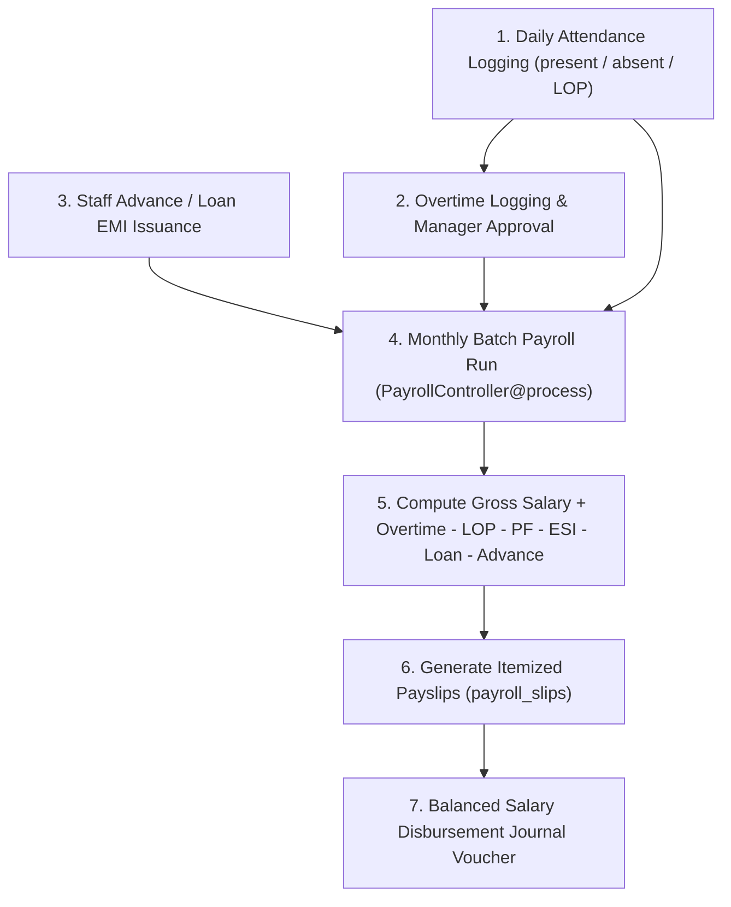
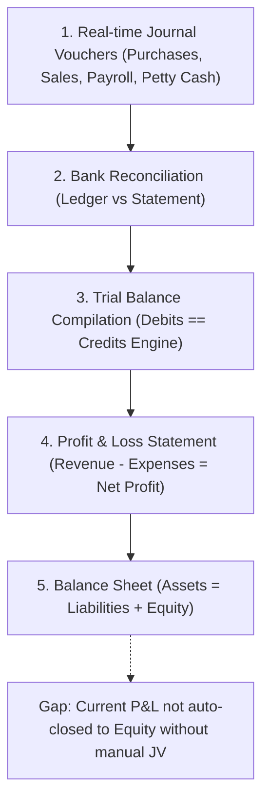
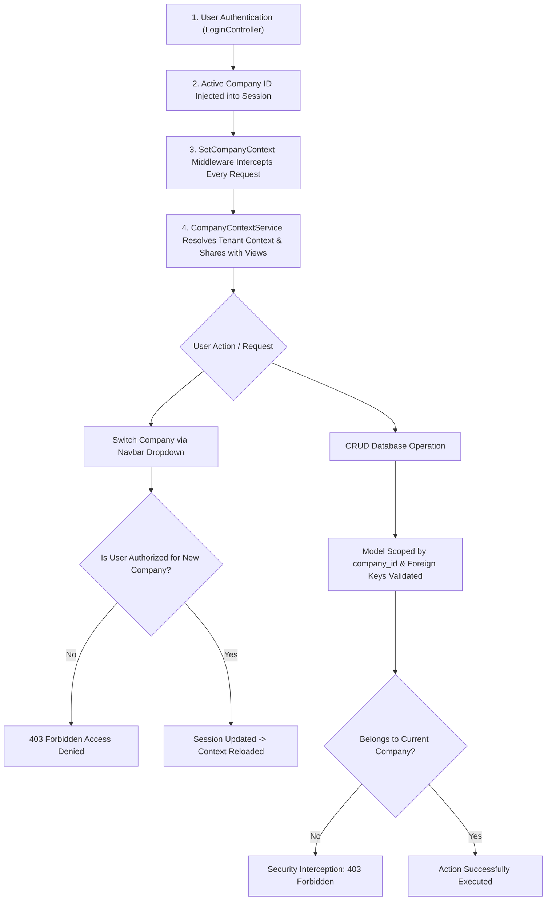

# Common ERP – Complete Business Workflows & Execution Tracing

This document provides a rigorous, step-by-step trace of the seven (7) primary business workflows operational within Common ERP. Each workflow details the exact database transactions, inventory stock movements, double-entry financial journal postings, and verification evidence.

---

## Workflow A: Purchase-to-Pay (P2P)

The Procure-to-Pay workflow handles the procurement of raw materials, trading inventory, or operating supplies from external vendors, incorporating multi-currency additional landed charges and automated double-entry ledger postings.



### Step-by-Step Execution Trace

#### 1. Purchase Requisition & Purchase Order
- **Requisition (`purchase_requests`)**: Departments log requested items and quantities. Department head approves.
- **Purchase Order (`purchase_orders`)**: Created via `PurchaseController@storeOrder`. Captures vendor ID, expected delivery date, item unit prices, and applicable tax rates (`purchase_order_items`). Status set to `sent`.

#### 2. Goods Receipt Note & Landed Cost Allocation
- Handled in `PurchaseController@storeEntry`.
- Supports additional charges (freight, customs, insurance) in `purchase_charges`.
- **Allocation Engine**: Line items receive an allocated share of landed charges using three configurable algorithms:
  1. `by_value`: Ratio of item line subtotal to total merchandise value.
  2. `by_quantity`: Ratio of item quantity to total shipment units.
  3. `equal`: Divided equally across line items.
- Line item landed unit cost = `(item_subtotal + allocated_charges) / quantity`.

#### 3. Stock Inward Posting
- Executed via `\App\Services\InventoryService::recordInward()`.
- Updates `inventory_stocks` with:
  - `company_id`, `warehouse_id`, `product_id`, `batch_no`, `expiry_date`.
  - Increments `current_stock`.
  - Sets `cost_price` to the calculated landed unit cost.
- Appends an audit row to `stock_ledger_entries` with `transaction_type = 'PURCHASE'`.

#### 4. Double-Entry Accounting Posting
- Executed via `\App\Services\AccountingService::createJournalVoucher()`.
- **Purchase Journal Voucher**:
  - **Debit**: Inventory / Purchase Account (`11000 - Inventory / Stock on Hand` or `51000 - Purchases`)
  - **Debit**: Input Tax Account (`13100 - Input GST / Tax Asset`)
  - **Credit**: Accounts Payable (`21000 - Accounts Payable / Sundry Creditors`)
  - Debits equal Credits within 0.05 tolerance.

#### 5. Supplier Payment Disbursement
- Handled in `PurchaseController@storePayment`.
- Records `supplier_payments` linked to supplier and purchase invoices.
- **Disbursement Journal Voucher**:
  - **Debit**: Accounts Payable (`21000 - Accounts Payable`)
  - **Credit**: Bank / Cash Account (`10100 - Cash on Hand` or `10200 - Bank Current Account`)
- Supplier ledger balance is automatically decremented.

---

## Workflow B: Order-to-Cash (O2C)

The Order-to-Cash workflow governs the sale of goods to wholesale distributors, commercial clients, or retail counter customers.



### Step-by-Step Execution Trace

#### 1. Sales Quotation & Sales Order
- Handled via `SalesController@storeQuotation` and `SalesController@storeOrder`.
- Checks customer credit limit against outstanding receivables.
- Reserves order line items in `sales_order_items`.

#### 2. Invoicing, Unit Conversion & Stock Deduction
- Executed in `SalesController@storeInvoice`.
- **Unit Conversion**: If sales unit differs from product base unit (e.g., selling in 'Boxes of 12' or 'Grams'), `\App\Services\UnitConversionService::convertToBase()` computes the exact base quantity.
- **Negative Stock Verification**: `\App\Services\InventoryService::recordOutward()` verifies available physical inventory in the designated warehouse.
  - If `current_stock < requested_base_quantity`, the transaction is rolled back with an explicit `RuntimeException("Insufficient stock")`.
- If valid:
  - Decrements `current_stock` in `inventory_stocks`.
  - Appends record to `stock_ledger_entries` with `transaction_type = 'SALES'`.

#### 3. Double-Entry Accounting Posting
- **Sales Journal Voucher**:
  - **Debit**: Accounts Receivable (`12000 - Accounts Receivable / Debtors`)
  - **Credit**: Sales Revenue Account (`41000 - Sales Revenue`)
  - **Credit**: Output Tax Liability (`22100 - Output GST / Tax Payable`)

#### 4. Delivery & Logistics Dispatch
- Pending invoices are assigned to vehicles and routes via `SalesController@assignDelivery`.
- Creates a `sales_deliveries` record.
- Dispatch driver updates status: `assigned` -> `in_transit` -> `delivered`.

#### 5. Counter / Accounts Receivable Collection
- Executed via `SalesController@storeReceipt` (or automatically during POS billing).
- **Collection Journal Voucher**:
  - **Debit**: Cash / Bank Account (`10100 - Cash` or `10200 - Bank`)
  - **Credit**: Accounts Receivable (`12000 - Accounts Receivable`)
- Customer outstanding balance decremented immediately.

---

## Workflow C: Inventory Transfer & Physical Stock Adjustment

Controls inter-warehouse stock rebalancing and physical stock audit reconciliations.



### Step-by-Step Execution Trace

#### 1. Two-Step Inter-Warehouse Stock Transfer
1. **Initiate Transfer**: Handled in `InventoryController@storeTransfer`. Defines source warehouse, destination warehouse, items, and transfer quantities. Status = `pending`.
2. **Dispatch Transfer**: Handled in `InventoryController@dispatchTransfer`.
   - Validates that source warehouse belongs to active tenant.
   - Invokes `InventoryService::dispatchTransfer()`.
   - Deducts stock from source warehouse via `recordOutward()`.
   - Updates status to `in_transit`.
3. **Receive Transfer**: Handled in `InventoryController@receiveTransfer`.
   - Validates destination warehouse belongs to active tenant.
   - Invokes `InventoryService::receiveTransfer()`.
   - Increments stock in destination warehouse via `recordInward()`.
   - Updates status to `completed`.
- Verified in `DailyOperationsManagementTest` and `TenantBoundarySecurityTest` (rejects cross-company warehouse transfers).

#### 2. Stock Physical Adjustment
- Handled in `InventoryController@storeAdjustment`.
- Records physical count discrepancies (Damage, Wastage, Spoilage, Shrinkage, Audit Correction).
- Invokes `InventoryService::adjustStock()`.
- Updates `inventory_stocks.current_stock` to physical quantity.
- Logs positive or negative quantity delta to `stock_ledger_entries`.

---

## Workflow D: Daily Production & Multi-Industry Manufacturing

The core manufacturing engine for batch-based industries (Food Processing, Garment Stitching, Chemical/Beverage Bottling).



### Step-by-Step Execution Trace

#### 1. Template-Driven Production Setup
- Process definitions stored in `industry_process_templates` containing:
  - Standard raw material consumption ratios.
  - Expected yield and scrap percentages.
  - Piece-rate worker labor rates.
  - Automatic finished goods distribution rules across retail branches.

#### 2. Daily Operation Recording & Labor Tallying
- Initiated in `DailyOperationController@store`.
- Records:
  - Header: `daily_operations` (`batch_number`, `operation_date`, `shift`).
  - Inputs: `daily_operation_materials` (`material_type = 'raw_material'`).
  - Labor: `daily_operation_workers` (worker piece-rate units produced x rate = `labor_cost`).
  - Outputs: `daily_operation_materials` (`material_type = 'finished_good'`).

#### 3. Multi-Stage Lifecycle & Atomic Completion
- Status sequence: `draft` -> `submitted` -> `approved` -> `completed`.
- Upon `DailyOperationService::completeOperation()`:
  - **Atomic Stock Deduction**: Consumed raw materials deducted from production warehouse via `InventoryService::recordOutward()`.
  - **Atomic Finished Goods Inward**: Finished product credited to production warehouse via `InventoryService::recordInward()`.
  - **Auto Stock Distribution**: Reads template distribution percentages and automatically initiates two-step `stock_transfers` to retail/depot branches.
- **Architectural Gap**: No double-entry financial journal is posted to transfer Raw Materials & Labor Payable into Work-In-Progress (WIP) or Finished Goods Inventory.

---

## Workflow E: Employee Attendance to Payroll Disbursement

Governs workforce attendance, overtime, advance recovery, and statutory payroll generation.



### Step-by-Step Execution Trace

#### 1. Attendance & Overtime Capture
- Attendance captured daily via `StaffController@storeAttendance` or `@bulkAttendance`.
- Tracks `present`, `absent`, `half_day`, `leave`.
- Overtime captured via `StaffController@storeOvertime` and approved by authorized manager (`overtimes.is_approved = 1`).

#### 2. Monthly Payroll Calculation Engine
- Executed in `PayrollController@process`.
- Iterates over all active staff in the tenant company for the designated month:
  1. **Calendar Base**: Resolves total calendar days in the month (e.g., 30 or 31).
  2. **LOP Deduction**: `(Monthly Basic / Calendar Days) * Unapproved Absent Days`.
  3. **Overtime Earnings**: `Approved OT Hours * Hourly OT Rate`.
  4. **Statutory Deductions**:
     - Employee Provident Fund (PF): 12% on applicable basic (if eligible).
     - Employee State Insurance (ESI): 0.75% on gross (if eligible).
  5. **Loan & Advance Recovery**: Queries `staff_loans` and `advances`, calculating due monthly EMI and deducting from net pay.
  6. **Net Salary**: `(Gross Salary - LOP + OT) - (PF + ESI + Loan EMI + Advance Recovery)`.

#### 3. Payslip & Double-Entry Disbursement Voucher
- Saves itemized slip in `payroll_slips`.
- Generates balanced journal voucher via `AccountingService::createJournalVoucher()`:
  - **Debit**: Salaries & Wages Expense (`52000 - Salaries & Wages`)
  - **Credit**: PF Payable Liability (`23100 - PF Payable`)
  - **Credit**: ESI Payable Liability (`23200 - ESI Payable`)
  - **Credit**: Staff Loan Asset / Advance Asset (`12500 - Staff Advances Recovered`)
  - **Credit**: Bank / Net Salary Payable (`10200 - Bank Account` or `23000 - Salaries Payable`)
- Debits strictly equal Credits. Verified in `ErpCompleteWorkflowTest`.

---

## Workflow F: Financial Period Close & Trial Balance Generation

Manages financial reconciliations, petty cash vouchers, and financial statement generation.



### Step-by-Step Execution Trace

#### 1. Bank Reconciliation
- Handled in `AccountingController@storeBankReconciliation`.
- Matches ERP bank ledger transactions against bank statement closing balance.
- Tracks uncleared cheques and deposits in transit.

#### 2. Petty Cash Management
- Recorded via `AccountingController@storePettyCash`.
- Debits operating expense account and credits Petty Cash asset account (`10150 - Petty Cash`).

#### 3. Trial Balance Generation
- Executed in `ReportController@trialBalance`.
- Iterates through all Chart of Accounts records belonging to the active company.
- Sums all debit entries and credit entries from `journal_entries` within the financial year.
- Validates that `Total Debits == Total Credits`.
- Verified in `ErpCompleteWorkflowTest` and `NewErpModulesCompleteTest`.

#### 4. Profit & Loss & Balance Sheet
- **P&L**: Computes Total Income (`account_type = 'Revenue'`) minus Total Expenses (`account_type = 'Expense'`). Returns Net Profit or Loss.
- **Balance Sheet**: Displays Assets vs Liabilities & Equity.
  - **Known Gap**: Net Profit from P&L is not dynamically appended to the Equity section of the Balance Sheet. A manual year-end closing journal entry must be posted to transfer Net Profit into Retained Earnings.

---

## Workflow G: Multi-Company Context Switching & Data Isolation

Enforces bulletproof tenant isolation across the shared database architecture.



### Step-by-Step Execution Trace

#### 1. Authentication & Context Initialization
- Upon login, standard Laravel authentication resolves the user.
- If user belongs to multiple companies, the primary company ID is stored in `session(['active_company_id'])`.

#### 2. Middleware Interception (`SetCompanyContext`)
- Every HTTP request passing through the `web` middleware group executes `\App\Http\Middleware\SetCompanyContext`.
- Resolves company from session.
- If invalid or inaccessible to the user, falls back to the user's default company.
- Configures `\App\Services\CompanyContextService::setActiveCompanyId($companyId)`.
- Injects current company into Blade view globals: `view()->share('currentCompany', $company)`.

#### 3. Context Switching
- Executed in `CompanyController@switchCompany`.
- Super-administrators can switch across all companies. Standard users can switch only between companies linked in `user_companies`.
- Attempts to switch to an unauthorized company immediately abort with `403 Forbidden`.

#### 4. Cross-Tenant Tampering Interception
- Every resource controller explicitly checks ownership before modifying or viewing an entity:
  ```php
  if ($customer->company_id !== CompanyContextService::getActiveCompanyId()) {
      abort(403, 'Unauthorized company access');
  }
  ```
- All foreign keys submitted via POST/PUT requests (e.g., `customer_id`, `warehouse_id`, `supplier_id`) are validated using company-scoped rules:
  ```php
  Rule::exists('customers', 'id')->where('company_id', $activeCompanyId)
  ```
- Validated by 15 automated negative security tests in `tests/Feature/TenantBoundarySecurityTest.php`.

