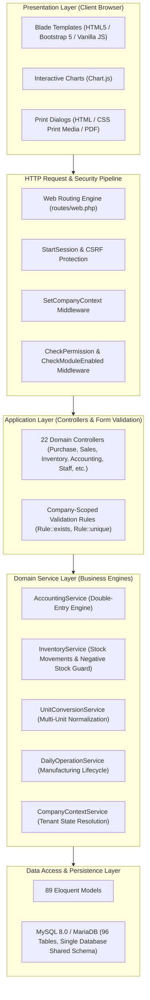
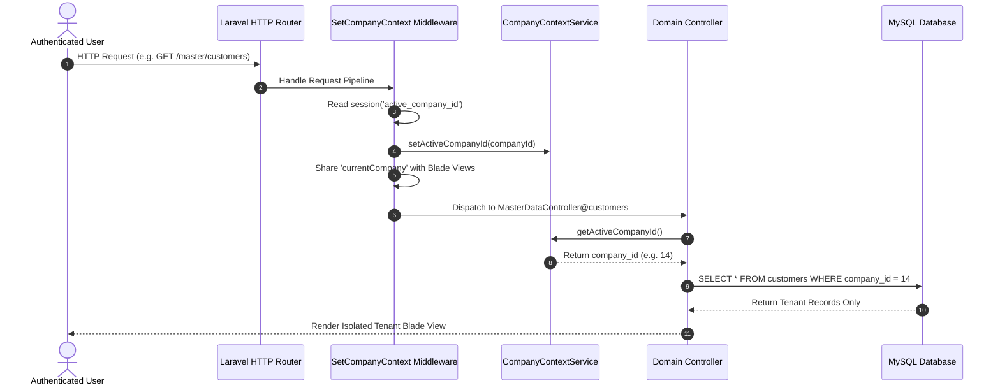
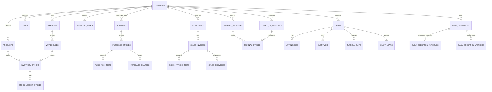

# Common ERP – Complete Project Architecture & Technical Blueprint

This document provides the definitive architectural blueprint of Common ERP, detailing the system topology, multi-tenancy implementation, service layer, database schema relationships, middleware pipeline, and software engineering patterns.

---

## 1. System Topology & Technology Stack

Common ERP is structured as a **monolithic, server-side rendered enterprise web application** built upon the Laravel framework.



### Technology Matrix
| Layer | Technology | Version | Purpose |
| :--- | :--- | :--- | :--- |
| **Runtime Environment** | PHP | `8.2.4` | Application runtime |
| **Web Framework** | Laravel | `10.50.4` | Application foundation, routing, ORM |
| **Relational Database** | MySQL / MariaDB | `8.0+ / 10.4+` | Relational data persistence |
| **Front-End Styling** | Bootstrap | `5.3.x` | Responsive grid and UI components |
| **Icons & Visuals** | FontAwesome / Bootstrap Icons | `6.x` | Vector interface iconography |
| **Data Visualizations** | Chart.js | `3.x / 4.x` | Executive dashboard KPI charts |
| **PDF Generation** | DomPDF / Blade Print CSS | Latest | Printable invoice and payslip rendering |
| **Testing Harness** | PHPUnit | `10.5.x` | Automated feature, integration, and security testing |

---

## 2. Directory Structure & Code Organization

The codebase adheres to standard Laravel conventions, with business logic centralized in a dedicated Service layer:

```
common-erp/
├── app/
│   ├── Http/
│   │   ├── Controllers/          # 23 Controllers (Base Controller + 22 Functional)
│   │   │   ├── AccountingController.php
│   │   │   ├── CompanyController.php
│   │   │   ├── DailyOperationController.php
│   │   │   ├── DashboardController.php
│   │   │   ├── InventoryController.php
│   │   │   ├── MasterDataController.php
│   │   │   ├── PayrollController.php
│   │   │   ├── PurchaseController.php
│   │   │   ├── ReportController.php
│   │   │   ├── RoleController.php
│   │   │   ├── SalesController.php
│   │   │   ├── StaffController.php
│   │   │   └── UserController.php
│   │   └── Middleware/           # 12 Middleware (SetCompanyContext, CheckPermission, etc.)
│   ├── Models/                   # 89 Eloquent Models
│   │   ├── Company.php, Branch.php, Warehouse.php, User.php
│   │   ├── ChartOfAccount.php, JournalVoucher.php, JournalEntry.php
│   │   ├── Product.php, Category.php, Unit.php, UnitConversion.php
│   │   ├── Customer.php, Supplier.php, Route.php, Vehicle.php
│   │   ├── PurchaseOrder.php, PurchaseEntry.php, PurchaseCharge.php
│   │   ├── SalesOrder.php, SalesInvoice.php, CustomerReceipt.php
│   │   ├── InventoryStock.php, StockLedgerEntry.php, StockTransfer.php
│   │   ├── DailyOperation.php, IndustryProcessTemplate.php
│   │   └── Staff.php, Attendance.php, PayrollPeriod.php, PayrollSlip.php
│   └── Services/                 # 5 Core Domain Services
│       ├── AccountingService.php
│       ├── CompanyContextService.php
│       ├── DailyOperationService.php
│       ├── InventoryService.php
│       └── UnitConversionService.php
├── config/                       # Configuration files (app, database, auth, permission)
├── database/
│   ├── migrations/               # Database migration schemas (96 tables)
│   └── seeders/                  # Master seeders (Roles, Industry Templates, Demo Data)
├── docs/                         # Official System Audit & Architectural Documentation (10 Files)
├── resources/
│   └── views/                    # 120 Blade templates across 15 subdirectories
├── routes/
│   ├── web.php                   # 233 Web routes
│   └── api.php                   # 1 Default Sanctum route
└── tests/
    └── Feature/                  # Automated integration, workflow, and security test suites
        ├── DailyOperationsManagementTest.php
        ├── ErpCompleteWorkflowTest.php
        ├── MultiIndustryDemoTest.php
        ├── NewErpModulesCompleteTest.php
        └── TenantBoundarySecurityTest.php
```

---

## 3. Multi-Tenancy Architecture & Execution Flow

Common ERP employs a **Single-Database, Column-Level Discriminator (`company_id`) Architecture**.



### The Three Layers of Tenant Defense
1. **Context Initialization**: `SetCompanyContext` intercepts every HTTP transaction, extracts the active company ID from session, verifies the user has access to it, and initializes `CompanyContextService`.
2. **Explicit Query Filtering**: Controllers filter all queries by `where('company_id', $companyId)` and verify single-entity ownership before rendering edit or view screens.
3. **Foreign Key Scope Validation**: Form Requests and controllers validate submitted foreign keys against the active company ID (e.g., `Rule::exists('customers', 'id')->where('company_id', $cid)`), completely preventing cross-tenant data association.

---

## 4. Domain Service Architecture

Business logic is encapsulated in five dedicated domain services rather than bloated controllers:

### 1. `AccountingService.php`
- **Responsibilities**:
  - `createJournalVoucher(companyId, voucherData, entries)`: Validates balanced debits and credits within 0.05 tolerance, verifies active financial year, writes `journal_vouchers` and `journal_entries`, and updates running account balances.
  - `recalculateAccountBalances(companyId, accountId)`: Recalculates closing balances from raw transaction journals.

### 2. `InventoryService.php`
- **Responsibilities**:
  - `recordInward(companyId, warehouseId, productId, qty, costPrice, ...)`: Updates physical stock, computes weighted-average cost, logs to `stock_ledger_entries`.
  - `recordOutward(companyId, warehouseId, productId, qty, ...)`: Enforces row locking (`lockForUpdate`), verifies stock availability, throws `RuntimeException` on negative stock, decrements stock, logs to ledger.
  - `dispatchTransfer()` & `receiveTransfer()`: Executes two-step transit state transitions.
  - `adjustStock()`: Reconciles physical count audit discrepancies.

### 3. `UnitConversionService.php`
- **Responsibilities**:
  - `convertToBase(productId, quantity, fromUnit)`: Converts secondary measurement units (e.g., Boxes of 12, Sacks of 50kg, Grams) to the item's canonical base unit.
  - Evaluates dimensional safety across Weight, Volume, Count, and Length dimensions.

### 4. `DailyOperationService.php`
- **Responsibilities**:
  - Manages operational lifecycle: `draft` -> `submitted` -> `approved` -> `completed`.
  - Calculates worker piece-rate wages.
  - Executes atomic stock deduction of raw materials and stock inward of finished products upon completion.
  - Triggers automated inter-branch distribution transfers based on template rules.

### 5. `CompanyContextService.php`
- **Responsibilities**:
  - Singleton tenant registry tracking `active_company_id`.
  - Provides helper methods: `getActiveCompanyId()`, `getActiveCompany()`, `setActiveCompanyId($id)`.

---

## 5. Core Database Schema & Entity Relationships



---

## 6. Architectural Debt & Future Refactoring Roadmap

To evolve Common ERP into a world-class, enterprise-grade architecture, the following refactoring actions are recommended:

1. **Global Eloquent `TenantScope` Implementation**:
   - Transition from manual controller `where('company_id')` filtering to an automatic Global Scope attached via a `BelongsToTenant` trait. This guarantees that developer oversight can never lead to cross-tenant data leakage.
2. **Event-Driven Architecture (EDA) via Laravel Events**:
   - Currently, controllers call `InventoryService` and `AccountingService` sequentially.
   - Refactor to domain events (e.g. `PurchaseEntryRecorded`, `SalesInvoiceCreated`, `ManufacturingBatchCompleted`).
   - Dedicated listeners (`UpdateInventoryStock`, `PostAccountingJournal`, `DispatchSmsAlert`) will handle downstream side effects asynchronously and independently.
3. **Repository Pattern & Command-Query Responsibility Segregation (CQRS)**:
   - Separate complex analytical reporting queries (`ReportController`) from transactional business operations (`PurchaseController`, `SalesController`) to optimize read and write workloads independently.
4. **REST / GraphQL API Layer**:
   - Decouple business logic into API-compatible Action classes (`app/Actions/`) allowing simultaneous support for web Blade interfaces, mobile applications, and external B2B integrations.

