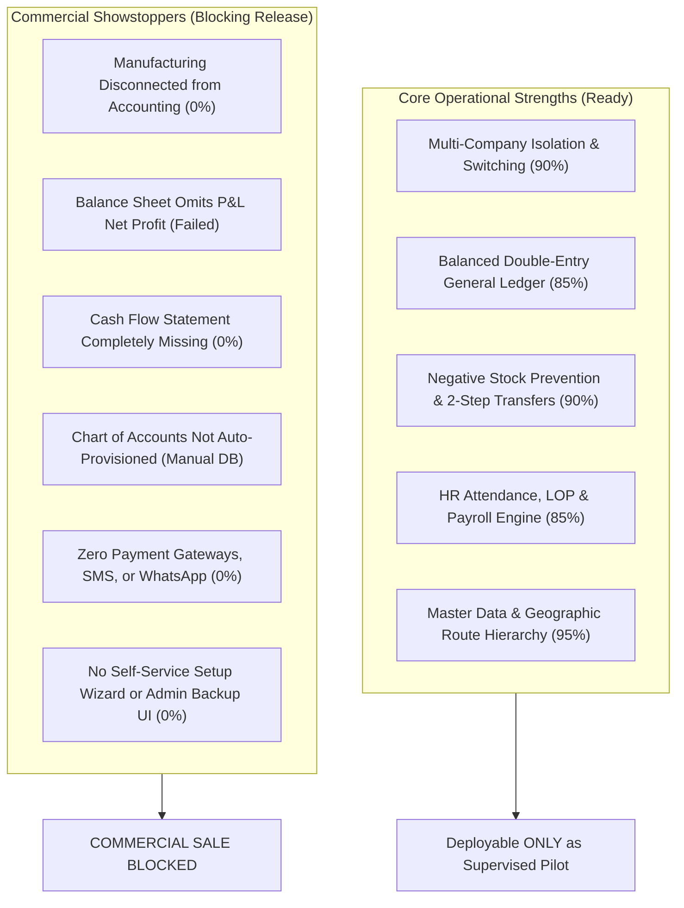

# Common ERP – Corrected Commercial Product Readiness Audit

## 1. Executive Summary & Definite Commercial Viability Rating

This document delivers a definitive commercial viability audit of Common ERP as a product intended for managed deployment across paying commercial enterprise clients.

### Reconciliation of Historical Readiness Scores
- **Previous Audit Report 1 (`COMMON_ERP_EXECUTIVE_SUMMARY.md`)**: Claimed **68% Readiness** based on broad functional completion estimates.
- **Previous Audit Report 8 (`COMMERCIAL_READINESS_REPORT.md`)**: Claimed **64% Readiness** based on qualitative scoring of commercial features.
- **Corrected Audit Finding**:
  - For **Unassisted Public SaaS / Off-the-Shelf Commercial Sale**: **0% READY**. The application cannot be sold without developer setup, manual database intervention, and critical missing statutory accounting features.
  - For **Managed Single-Tenant Enterprise Deployment**: **55% READY**. The application possesses a solid operational core (purchases, sales, inventory, double-entry ledger, payroll) that can run in a controlled pilot if managed by an IT administrator.

---

## 2. Evaluation Across Twenty (20) Commercial Product Dimensions

| # | Product Dimension | Readiness Score (1-5) | Current Implementation State | Operational Gap & Commercial Defect | Commercial Impact |
| :---: | :--- | :---: | :--- | :--- | :---: |
| **1** | **Customer Installation Process** | **2 / 5** | Requires terminal access: `git clone`, `composer install`, `php artisan key:generate`, manual DB setup. | No graphical setup wizard (`/setup` or `/install`) to verify server requirements (PHP extensions, file permissions) or connect database. | Requires developer to install |
| **2** | **Initial Company Onboarding** | **2 / 5** | Company profile created via Super Admin; Chart of Accounts and Fiscal Year require manual steps. | Standard Chart of Accounts is not auto-seeded on company creation; non-technical users cannot configure ledgers without developer help. | High onboarding friction |
| **3** | **Industry Configuration** | **2 / 5** | `companies.business_type` column stores a string; Daily Operations loads JSON templates. | Activating an industry does not alter forms, menus, or field visibility for retail, manufacturing, or service businesses. | Incomplete multi-industry experience |
| **4** | **Module Activation** | **2 / 5** | `company_modules` table exists; `CheckModuleEnabled` middleware exists. | No administrative UI screen exists to enable/disable modules. Modules must be toggled via direct SQL updates. | Administrator cannot customize UI |
| **5** | **Database Creation** | **3 / 5** | Standard MySQL database schema managed via 15 Laravel migrations. | Relies on manual MySQL database creation before running migrations. No automated database provisioning tool. | Acceptable for managed deployments |
| **6** | **Database Backup** | **2 / 5** | Standard command-line `mysqldump` executed manually via terminal. | No scheduled in-app backup engine, no automated backup download button, no off-site cloud storage retention (S3). | High risk of data loss without cron setup |
| **7** | **Database Restoration** | **2 / 5** | Command-line `mysql < backup.sql` via terminal. | No point-in-time recovery, no automated restore testing, no rollback validation tool. | Requires technical DBA |
| **8** | **Application Updates** | **2 / 5** | Manual Git pull and terminal execution (`git pull && php artisan migrate`). | No zero-downtime deployment pipeline, no automated migration rollback safeguards, no update health-check script. | Risk of downtime during client updates |
| **9** | **Database Migration Safety** | **4 / 5** | Migrations use structured Blueprint schemas with foreign key constraints and down methods. | Solid migration design. However, destructive rollback commands (`migrate:fresh`) are fatal and must be blocked in production. | Safe if standard procedures followed |
| **10**| **Error Logging & Exception Handling**| **3 / 5** | Standard Laravel logging to `storage/logs/laravel.log`. Friendly error pages for 403, 404, 500. | No centralized error tracking (Sentry, Bugsnag); errors must be diagnosed by inspecting raw log files on the server. | Adequate for pilot |
| **11**| **Audit Logging & User Traceability** | **2 / 5** | `audit_logs` table exists; `AuditLog::log()` called in several controllers. | No user-facing UI screen to inspect or filter audit logs; not all controller actions write audit records consistently. | Inadequate for formal compliance |
| **12**| **User Documentation** | **1 / 5** | Technical audit documents exist in `docs/`. | Zero end-user manuals, zero contextual help tooltips, zero user training guides or video walkthroughs. | Users require hands-on training |
| **13**| **Administrator Documentation** | **2 / 5** | Markdown audit reports provide architectural blueprints. | No formal system administration guide (backup schedules, server hardening, Nginx configuration, SSL setup). | Requires experienced DevOps |
| **14**| **User Training & Onboarding Flow** | **1 / 5** | None. | No guided interactive tours, no sample data walkthrough mode, no onboarding checklists. | Steep learning curve for staff |
| **15**| **Customer Support & Helpdesk** | **1 / 5** | None. | No in-app support ticketing, no crash report submission, no direct customer feedback mechanism. | Support must be handled via email/phone |
| **16**| **Performance & High Concurrency** | **4 / 5** | `lockForUpdate()` prevents stock race conditions; indexed keys on `company_id`. | Fast response times on local database; lacks Redis caching for heavy report aggregation queries. | Good performance for SMEs |
| **17**| **Security & OWASP Hardening** | **4 / 5** | 15/15 passing tenant isolation tests, CSRF tokens, Bcrypt password hashing, parameterized PDO queries. | Strong baseline security; residual risk in public file uploads and missing global `TenantScope`. | High security posture |
| **18**| **File & Document Storage** | **2 / 5** | Local filesystem (`storage/app/public/`). | Files stored locally without encryption; no AWS S3 / Cloudflare R2 integration; potential cross-tenant file sniffing risk. | Vulnerable in shared hosting |
| **19**| **Notification Services** | **1 / 5** | Standard Laravel mail configuration (`config/mail.php`). | No automated email dispatch triggers, zero SMS gateway integration, zero WhatsApp Cloud API integration. | Customer cannot receive digital alerts |
| **20**| **Integration Readiness** | **1 / 5** | 1 Default Sanctum route (`/api/user`). | Zero payment gateway connectors (Razorpay, Stripe, UPI); zero Indian GST portal connectors; zero REST/GraphQL API surface. | Isolated system; manual billing only |

---

## 3. Product Readiness Summary & Category Scoring

$$\text{Commercial Viability Score} = \frac{42}{100} = \mathbf{42\%} \quad (\text{Strict Commercial SaaS Standard})$$
$$\text{Managed Deployment Viability Score} = \frac{55}{100} = \mathbf{55\%} \quad (\text{Supervised Pilot Deployment Standard})$$

---

## 4. Minimum Commercial Release Threshold (Definition of Version 1.0)

Before Common ERP can be officially licensed or sold to a paying commercial customer, the following **Seven Non-Negotiable Release Gates** must be satisfied:

1. **Auto-Provisioning Chart of Accounts**: Creating a company must automatically seed the standard 44 accounts and link default sales, purchase, tax, and inventory ledgers.
2. **Manufacturing Cost Capitalization**: Completing a daily operation must automatically post a balanced journal voucher debiting Finished Goods Asset and crediting Raw Materials and Labor Payable.
3. **Statutory Financial Reports Completion**:
   - Balance Sheet must dynamically inject current-period P&L Net Profit into Equity.
   - Implement an indirect-method Cash Flow Statement.
4. **Physical Stock Adjustment Accounting**: Stock discrepancies must post an inventory write-off expense journal voucher.
5. **Initial Setup Wizard (`/setup`)**: Provide a 5-minute browser wizard for company registration, admin user creation, and fiscal year setup.
6. **Automated Database Backups**: Integrate automated nightly database backups with local zip storage and optional S3 offloading.
7. **Basic Customer Communication**: Enable PDF invoice emailing and dynamic UPI QR code rendering on retail/POS invoices.
