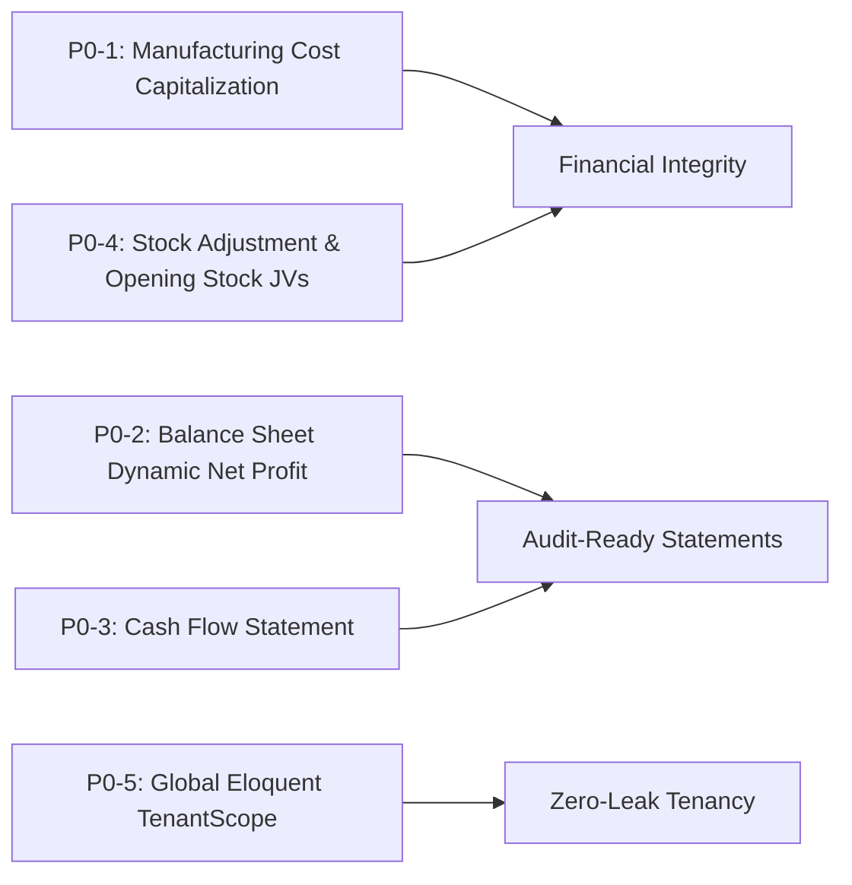

# Common ERP – Prioritized Development Roadmap (P0, P1, P2, P3)

This document establishes the official, dependency-ordered engineering priorities required to evolve Common ERP from its current operational prototype state into a commercially viable, multi-industry enterprise platform.

---

## Priority Classification Framework
- **`P0 – CRITICAL (RELEASE BLOCKERS)`**: Flaws that cause financial ledger distortion, data loss, cross-tenant leaks, or statutory audit failure. Must be resolved before onboarding any paying client.
- **`P1 – ESSENTIAL COMMON ERP (VERSION 1.0 CORE)`**: Foundational onboarding, operational completeness, and reporting capabilities required for standard commercial operation.
- **`P2 – MULTI-INDUSTRY CAPABILITIES (VERSION 1.1–1.2 VERTICALS)`**: Reusable vertical engines (MRP, BOMs, Quality Lab, Apparel Matrix, Returnable Crates, Dynamic Pricing).
- **`P3 – COMMERCIAL EXPANSION & ADVANCED AUTOMATION (VERSION 2.0+)`**: Mobile apps, SaaS multi-tenant billing, advanced integrations, and AI features.

---

## 1. P0 – Critical Priorities (Immediate Engineering Focus)

| ID | Title & Scope | Architectural Component | Files / Modules Affected | Business Justification & Risk |
| :---: | :--- | :--- | :--- | :--- |
| **P0-1** | **Manufacturing Cost Capitalization Journal Posting** | Domain Service Integration | `app/Services/DailyOperationService.php` `app/Services/AccountingService.php` | **Highest Financial Risk.** Factory production consumes physical materials and labor without posting accounting entries. Generates balanced JV debiting Finished Goods Asset and crediting Raw Materials and Labor Payable. |
| **P0-2** | **Dynamic P&L Closing in Balance Sheet** | Financial Reporting Engine | `app/Http/Controllers/ReportController.php` (`balanceSheet`) | **Statutory Audit Failure.** Balance sheet currently omits current period Net Profit/Loss, rendering Assets != Liabilities + Equity. Modify method to inject calculated Net Profit under Equity dynamically. |
| **P0-3** | **Implementation of Cash Flow Statement** | Financial Reporting Engine | `app/Http/Controllers/ReportController.php` `resources/views/reports/financial/cash_flow.blade.php` | Required by banks, tax authorities, and business owners. Implement indirect cash flow method (Net Profit + Depr/Non-cash +/- Working Capital changes). |
| **P0-4** | **Inventory Adjustments & Opening Stock Accounting Entries** | Inventory & Accounting Integration | `app/Http/Controllers/InventoryController.php` (`adjustmentStore`, `openingStockStore`) | Opening stock and stock write-offs currently update physical stock but do not post accounting entries, causing ledger vs valuation divergence. |
| **P0-5** | **Global Eloquent `TenantScope` Enforcement** | Core Security Framework | `app/Models/Scopes/TenantScope.php` `app/Traits/BelongsToTenant.php` All 66 Tenant Models | Eliminates reliance on manual controller `where('company_id')` filtering. Guarantees that future code or raw scripts cannot accidentally expose cross-company data. |

---

## 2. P1 – Essential Common ERP (Version 1.0 General Release)

| ID | Title & Scope | Architectural Component | Files / Modules Affected | Business Justification |
| :---: | :--- | :--- | :--- | :--- |
| **P1-1** | **Automated Chart of Accounts Auto-Seeding on Company Creation** | Company Provisioning | `app/Http/Controllers/CompanyController.php` `database/seeders/CompanyAccountsSeeder.php` | Enables non-technical business owners to create a company and start invoicing immediately without manual database intervention. |
| **P1-2** | **First-Time Setup & Onboarding Wizard (`/setup`)** | System Administration | `app/Http/Controllers/SetupWizardController.php` `resources/views/setup/wizard.blade.php` | Streamlines installation: prompts for company profile, tax numbers, industry vertical, and admin password in a 5-step UI. |
| **P1-3** | **Module Activation & Menu Toggle UI Screen** | Administration & RBAC | `app/Http/Controllers/SettingsController.php` `resources/views/settings/modules.blade.php` | Allows company admin to enable/disable modules (e.g. turn off Manufacturing or Fleet routes for pure retail shops). |
| **P1-4** | **Automated Database Backup with Local & Cloud Export** | Maintenance & Reliability | `app/Console/Kernel.php` Integration of `spatie/laravel-backup` | Automatically dumps database nightly, zips local files, and provides an admin download button + optional Amazon S3 upload. |
| **P1-5** | **Automated Transactional Email Invoicing** | Customer Communication | `app/Mail/SalesInvoiceMail.php` `app/Http/Controllers/SalesController.php` | Automatically dispatches PDF invoices and payment receipts to customer emails upon invoice generation. |
| **P1-6** | **Universal Data Export (Excel / CSV) Across All Data Tables** | Reporting & BI | Integration of DataTables Buttons / `maatwebsite/excel` | Enables finance teams to export Customers, Suppliers, Ledgers, Invoices, and Stock tables with a single click. |
| **P1-7** | **Dynamic UPI QR Code on Counter POS & Invoices** | Retail & Payments | `resources/views/sales/pos.blade.php` `resources/views/sales/invoice_pdf.blade.php` | Generates standardized NPCI Bharat UPI QR codes on bills for instant mobile customer payments. |

---

## 3. P2 – Multi-Industry Capabilities (Version 1.1–1.2 Verticals)

| ID | Title & Scope | Target Industry Verticals | Architectural Component | Scope & Implementation Blueprint |
| :---: | :--- | :--- | :--- | :--- |
| **P2-1** | **Discrete Manufacturing Engine (BOM & Production Orders)** | Engineering, Furniture, Machinery, Electronics | Manufacturing MRP Domain | Build `BomController` and `ProductionOrderController`, wiring existing MySQL tables `boms` and `production_orders` to UI screens and `InventoryService`. |
| **P2-2** | **Quality Control & Lab Inspection UI** | Food Processing, Beverages, Chemicals, Pharma | Quality Domain | Build `QualityCheckController` and inspection views; implement quality gating: stock remains in `quarantine` until QC approval. |
| **P2-3** | **Apparel 2D Size x Color Variant Generator** | Garment Retail & Fashion Boutiques | Master Data Domain | Dynamic matrix generator creating item SKU permutations (S, M, L, XL x Colors) with barcode generation. |
| **P2-4** | **Returnable Packaging & Crate Deposit Ledger** | Beverage Bottling & Distribution | Inventory & Accounting | Tracks returnable asset balances (glass bottles, plastic crates) collected from and returned by retailers. |
| **P2-5** | **Driver Mobile Proof of Delivery (POD) Screen** | Logistics, FMCG & Distribution | Logistics & Sales | Responsive mobile PWA screen allowing drivers to mark deliveries, capture customer digital signatures, and upload photos. |
| **P2-6** | **Garment Cutting & Stitching Bundle Card Tracking** | Apparel Manufacturing & Tailoring | Manufacturing Domain | Generates printable barcode bundle cards tracking cut fabric parts through sequential tailor workstations. |
| **P2-7** | **Subcontracting & External Job-Work Management** | Engineering & Garments | Purchasing & Inventory | Issues outward job-work delivery challans, tracks raw materials with third-party job workers, and reconciles return scrap. |

---

## 4. P3 – Commercial Expansion & Advanced Automation (Version 2.0+)

| ID | Title & Scope | Architectural Component | Long-Term Strategic Benefit |
| :---: | :--- | :--- | :--- |
| **P3-1** | **Online Payment Gateway Connectors (Razorpay / Stripe SDK)** | Financial Integrations | Enables online invoice payment links and automated customer credit balance top-ups. |
| **P3-2** | **WhatsApp Business Cloud API Transactional Alerts** | Messaging Gateway | Automatically sends PDF invoices, payment receipts, and dispatch tracking links via WhatsApp. |
| **P3-3** | **Indian GST E-Way Bill & E-Invoice Government Portal Connector** | Statutory Compliance | Direct API integration with NIC / ClearTax for 1-click IRN generation and E-Way bill generation. |
| **P3-4** | **Offline Resilient Point of Sale (POS) via IndexedDB** | Retail Architecture | Allows retail counter billing to continue during internet outages and auto-sync when connection restores. |
| **P3-5** | **REST / GraphQL External API Gateway with Sanctum Tokens** | API Ecosystem | Enables mobile apps, third-party e-commerce connectors (Shopify, WooCommerce), and automated warehouse scanners. |
| **P3-6** | **Automated Multi-Tenant SaaS Subscription Billing Engine** | SaaS Enablement | Self-service tenant signup, credit card billing via Stripe/Paddle, automated tenant database provisioning. |
| **P3-7** | **AI-Powered Demand Forecasting & Automated Reordering** | Business Intelligence | Analyzes historical consumption trends to predict raw material procurement timelines. |
