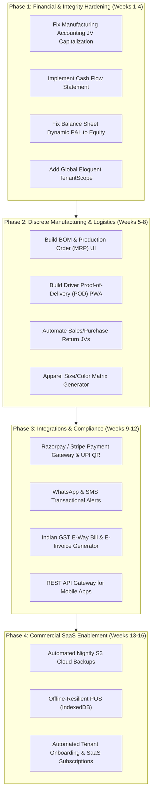

# Common ERP – Missing Features & Gap Analysis

This document provides an exhaustive, classified inventory of all functional, architectural, operational, and integration gaps identified during the complete technical audit of Common ERP.

---

## 1. Classification & Severity Matrix

- **`CRITICAL`**: Fundamental business or accounting failure that distorts financial statements, violates core ERP principles, or causes transactional data loss/desynchronization.
- **`HIGH`**: Missing core ERP features that prevent specific industries or enterprise departments from operating using the software.
- **`MEDIUM`**: Operational friction, missing automation, or reporting omissions that require manual administrator or accountant workarounds.
- **`LOW`**: Ergonomic, UI/UX polish, or advanced secondary optimizations.

---

## 2. Comprehensive Gap Inventory

| # | Domain | Gap Title | Severity | Current Implementation State | Technical Blueprint for Resolution |
| :--- | :--- | :--- | :---: | :--- | :--- |
| **1** | **Manufacturing / Accounting** | **Manufacturing Cost Capitalization Disconnect** | `CRITICAL` | `DailyOperationService` updates physical inventory atomically but posts zero journal vouchers. Inventory asset ledger does not reflect manufacturing costs. | Update `DailyOperationService@completeOperation` to invoke `AccountingService::createJournalVoucher()`: Debit Finished Goods Inventory, Credit Raw Materials Inventory, Credit Labor Payable. |
| **2** | **Reporting / Accounting** | **Absence of Cash Flow Statement** | `CRITICAL` | Completely missing from `ReportController` and Blade views. Enterprises cannot track operating, investing, and financing cash flows. | Implement `ReportController@cashFlow` using the indirect method: Net Profit + Non-Cash Expenses +/- Working Capital Changes = Cash from Operations. |
| **3** | **Reporting / Accounting** | **Dynamic P&L to Equity Closing in Balance Sheet** | `CRITICAL` | Balance Sheet calculates Assets and Liabilities/Equity separately; does not dynamically append Net Profit/Loss to Retained Earnings without manual year-end JV. | Modify `ReportController@balanceSheet` to compute period Net Profit on-the-fly and inject it as a virtual line item under Equity before computing totals. |
| **4** | **Manufacturing (MRP)** | **Discrete Manufacturing BOM & Work Orders UI Missing** | `HIGH` | Tables `boms`, `bom_items`, `production_orders`, `quality_checks` exist in MySQL, but have no routes, controllers, or Blade views. | Implement `BomController` and `ProductionOrderController`, create CRUD views in `resources/views/manufacturing/`, and link with `InventoryService`. |
| **5** | **Integrations** | **Zero Payment Gateway Integration** | `HIGH` | Only manual Cash, Bank Transfer, or Cheque can be selected. No online customer payment link or POS dynamic UPI QR code. | Integrate Razorpay / Stripe SDK: generate checkout links on sales invoices and dynamic UPI QR codes on POS receipt prints. |
| **6** | **Integrations** | **Zero Automated Messaging (SMS / WhatsApp)** | `HIGH` | Invoices and payment receipts cannot be dispatched directly to customer mobile devices. | Implement notification drivers for Twilio or WhatsApp Business Cloud API triggered upon invoice completion and payment receipt. |
| **7** | **Compliance (India)** | **GST E-Way Bill & E-Invoice Integration Absent** | `HIGH` | Indian tax compliance mandates E-Way bills for consignments > Rs. 50,000 and IRN for businesses > Rs. 5 Cr. No JSON payload generation or NIC API connector exists. | Build an E-Invoice generator service conforming to the NIC JSON schema with QR code rendering on invoices. |
| **8** | **Security / Architecture** | **Absence of Global Eloquent `TenantScope`** | `HIGH` | Multi-tenancy is enforced through explicit controller queries. If a developer omits `where('company_id')`, data leaks can occur. | Create `App\Models\Scopes\TenantScope` and attach via a `BelongsToTenant` trait across all 66 tenant Eloquent models. |
| **9** | **Logistics / Fleet** | **Proof of Delivery (POD) & Driver App Missing** | `HIGH` | Delivery trips have status flags (`in_transit`, `delivered`), but no driver mobile signature pad, geolocation check, or photo capture. | Develop a responsive mobile PWA driver screen allowing delivery status updates, customer signature capture, and photo uploads. |
| **10**| **Sales / Returns** | **Automated Sales & Purchase Return Credit/Debit Vouchers**| `MEDIUM` | Return records are logged, but restocking and automatic reversal journal vouchers require manual adjustments. | Enhance `SalesController@storeReturn` and `PurchaseController@storeReturn` to automatically post credit/debit notes and reverse inventory atomically. |
| **11**| **Master Data** | **Size & Color Matrix for Apparel / Garments** | `MEDIUM` | Garments require creating separate SKU rows manually for every size/color permutation. | Implement a dynamic Product Variant Generator allowing 2D grid generation (Sizes: S, M, L, XL x Colors: Red, Blue, Black). |
| **12**| **Jewellery Vertical** | **Dynamic Gold Rate Board & Making Charge Formulas** | `MEDIUM` | Product pricing is static; cannot calculate jewellery prices based on daily gold rate + making charges + stone weight. | Create `daily_gold_rates` table and compute jewellery invoice line prices dynamically: `(Net Weight * Daily Rate) + Making Charge`. |
| **13**| **System Administration** | **Audit Trail Log Viewer UI** | `MEDIUM` | Table `audit_logs` captures user operations, but administrators have no screen to view or filter activity logs. | Implement `AuditLogController` and a datatable view in `resources/views/admin/audit_logs.blade.php`. |
| **14**| **System Administration** | **Automated Database Backup & S3 Upload** | `MEDIUM` | Backups rely on manual command-line `mysqldump`. No automated daily backup or offsite cloud retention. | Configure `spatie/laravel-backup` to run nightly automated dumps and upload encrypted archives to Amazon S3. |
| **15**| **Architecture** | **REST / Mobile API Gateway** | `MEDIUM` | Only web session routes exist. Mobile applications or third-party webhooks cannot interact with the ERP. | Implement dedicated API controllers under `app/Http/Controllers/Api/` authenticated via Laravel Sanctum tokens. |
| **16**| **POS / Retail** | **Offline Resilient Point of Sale (POS)** | `MEDIUM` | POS billing requires an active internet connection. If connectivity drops, store checkout halts. | Implement IndexedDB local caching in JavaScript to store offline transactions and sync when connection restores. |
| **17**| **Financial Accounting** | **Automated Fiscal Year Closing Wizard** | `LOW` | Fiscal years can be locked, but closing nominal accounts into Retained Earnings must be executed via manual JV. | Build an automated Year-End Closing Wizard that generates closing JVs and creates opening balances for the new year. |
| **18**| **HR & Payroll** | **Employee Self-Service (ESS) Portal** | `LOW` | Staff members cannot log in to view their own payslips, apply for leave, or submit loan requests. | Create a restricted `Employee` role dashboard in `StaffController` allowing staff to download PDF payslips and apply for leave. |
| **19**| **Reporting / BI** | **Universal Data Export (Excel / PDF) Across All Screens**| `LOW` | Data grids display HTML tables, but lack universal single-click export buttons to XLSX/CSV/PDF. | Integrate DataTables Buttons extension or Laravel Excel (`maatwebsite/excel`) across all master and transactional listings. |
| **20**| **SaaS Enablement** | **Automated Tenant Self-Registration & Stripe Billing** | `LOW` | New companies must be created manually by a super-admin. No public registration landing page or subscription tiers. | Implement multi-tenant subscription billing engine with pricing tiers, seat limits, and automated self-onboarding. |

---

## 3. Recommended Phased Implementation Roadmap

