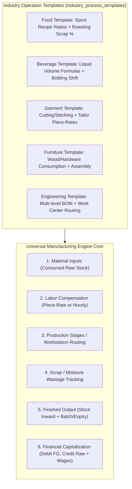
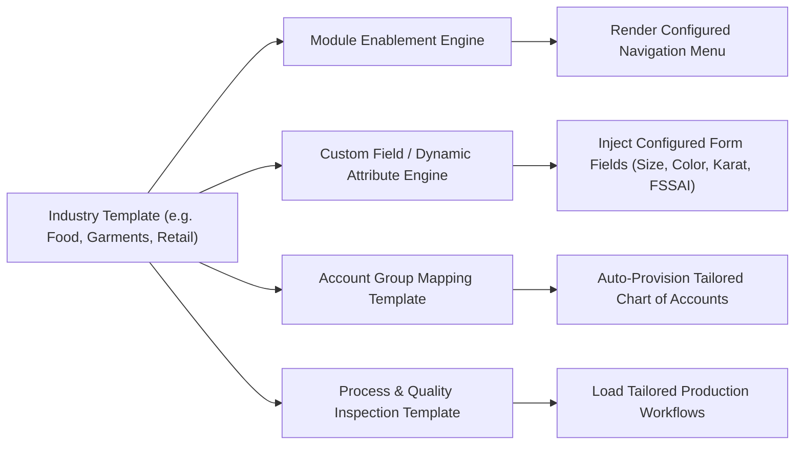

# Common ERP – Multi-Industry Architecture & Universal Engine Assessment

This document delivers an in-depth architectural assessment of Common ERP's ability to serve as a **single, unified, configurable multi-industry platform** using shared modules, configuration schemas, and vertical templates.

---

## 1. Common ERP Foundation: Reusability Assessment

A multi-industry ERP platform must distinguish between **universal foundational engines** (identical across all commercial enterprises) and **vertical-specific operational extensions**.

| Foundation Domain | Architectural Implementation | Degree of Reusability | Operational Notes |
| :--- | :--- | :---: | :--- |
| **Company & Multi-Tenant Core** | `CompanyController`, `CompanyContextService` | **100% Fully Reusable** | Universal tenant isolation and context resolution across all industries. |
| **Branch & Facility Structure** | `branches`, `godowns` | **100% Fully Reusable** | Maps factories, retail showrooms, central depots, and regional hubs identically. |
| **User & RBAC Security** | `users`, `roles`, `permissions`, `CheckPermission` | **100% Fully Reusable** | Granular permission matrix applies universally across all operational roles. |
| **Financial Accounting (Double-Entry)**| `AccountsController`, `AccountingService` | **100% Fully Reusable** | Standard GAAP/IFRS debits and credits apply identically across all commercial types. |
| **Procure-to-Pay (P2P)** | `PurchaseController`, `InventoryService` | **95% Reusable** | Universal PO, GRN inward, and vendor payments. Minor custom fields needed per industry. |
| **Order-to-Cash (O2C)** | `SalesController`, `InventoryService` | **90% Reusable** | Universal quotations, orders, and invoicing. Counter POS works for retail; van delivery for wholesale. |
| **Multi-Godown Inventory & Batches**| `godowns`, `stock_batches`, `stock_movements` | **90% Reusable** | Multi-location stock, weighted cost, batch/expiry tracking are universal for physical goods. |
| **Human Resources & Payroll** | `StaffController`, `PayrollController` | **100% Fully Reusable** | Attendance, LOP, approved overtime, loans, PF/ESI, and payroll disbursement are identical across industries. |

---

## 2. Reusable Functional Modules Classification

| Functional Module | Classification Status | Architectural State | Enhancement Needed for Multi-Industry Reusability |
| :--- | :--- | :--- | :--- |
| **General Ledger & Vouchers** | `Fully Reusable` | Production Ready | None. Completely universal. |
| **Multi-Unit Normalization** | `Fully Reusable` | Production Ready | Universal weight, volume, length, and count conversions. |
| **Retail Counter POS** | `Fully Reusable` | Production Ready | Needs offline caching (IndexedDB) for high-frequency supermarket checkout. |
| **Batch & Expiry Date Engine** | `Fully Reusable` | Production Ready | Enforces batch/expiry on both purchase inward and production output. |
| **Daily Operations Engine** | `Reusable with Configuration`| Operational Core | Needs double-entry accounting capitalization and machine cost tracking. |
| **Fleet & Delivery Route Engine**| `Reusable with Configuration`| Operational Core | Needs mobile driver POD screen and electronic customer signature capture. |
| **Bills of Material (BOM / MRP)**| `Partially Reusable` | Schema Only | Tables exist; must implement controller, UI, and explosion logic. |
| **Quality Control & Lab Inspection**| `Partially Reusable` | Schema Only | Tables exist; must implement UI and quarantine stock gate. |
| **Apparel Size/Color Matrix** | `Industry-Specific Implementation`| Not Implemented | Dedicated 2D grid variant generator needed for fashion/garments. |
| **Precious Metals Pricing Engine**| `Industry-Specific Implementation`| Not Implemented | Dynamic daily gold bullion rate board and net weight calculation. |
| **Returnable Packaging Ledger** | `Industry-Specific Implementation`| Not Implemented | Deposit asset accounting for glass bottles and crates in beverage industry. |
| **Project & Milestone Billing** | `Not Implemented` | Absent | Required for IT services, software development, and consultancy verticals. |
| **Machine Preventive Maintenance**| `Not Implemented` | Absent | Required for heavy engineering, industrial plants, and fleet mechanics. |

---

## 3. Manufacturing Architecture: Universal Engine Feasibility

A central question of this audit is: **Can a single manufacturing engine support spice blending, beverage bottling, garment stitching, furniture making, and machinery assembly?**

### Analysis of Twenty (20) Manufacturing Capabilities Across Target Verticals

| # | Manufacturing Capability | Spice Food Processing | Beverage Bottling | Garment Stitching | Furniture Works | Machinery Assembly | Universal Engine Verdict |
| :---: | :--- | :---: | :---: | :---: | :---: | :---: | :---: |
| **1** | Raw Material Consumption | Yes (Spices) | Yes (Sugar/Preforms) | Yes (Fabrics/Buttons)| Yes (Wood/Screws) | Yes (Components) | **Universal Core** |
| **2** | Finished Goods Inward | Yes (Masala Packs) | Yes (Bottled Drinks) | Yes (Finished Shirts)| Yes (Chairs/Tables) | Yes (Machines) | **Universal Core** |
| **3** | Semi-Finished Goods (WIP) | Roasted Spice | Blended Syrup | Cut Fabric Bundles | Cut Wood Parts | Sub-Assemblies | **Configurable Stages** |
| **4** | BOM / Recipe Definition | Recipe Ratios | Liquid Formulas | Cut Pattern BOM | Cutlist BOM | Multi-level BOM | **Universal Core** |
| **5** | Production Orders | Batch Runs | Daily Shifts | Cutting/Sewing Job | Work Orders | Project Orders | **Universal Core** |
| **6** | Material Reservation | Optional | Essential | Essential | Essential | Critical | **Universal Core** |
| **7** | Multiple Production Stages | Roasting -> Grinding | Syrup -> Bottling | Cutting -> Stitching | Milling -> Assembly | Fabrication -> Assembly | **Configurable Stages** |
| **8** | Piece-Rate Worker Labor | Common (Packing) | Rare | Standard (Tailors) | Common (Carpenters) | Rare | **Configurable Engine** |
| **9** | Machine Hourly Costs | Grinder Machine | Bottling Line | Sewing Machine | CNC Router | CNC Lathe | **Configurable Overhead**|
| **10**| Scrap & Wastage Tracking | Moisture Loss % | Preform Breakage | Fabric Offcuts | Sawdust / Offcuts | Metal Shavings | **Universal Core** |
| **11**| Batch & Expiry Tracking | Mandatory | Mandatory | Not Applicable | Not Applicable | Serial Numbers | **Configurable Flag** |
| **12**| Quality Lab Inspection | Mandatory | Mandatory | Inspection Gate | Final Inspection | Tolerance Testing | **Universal Core** |
| **13**| Finished Goods Distribution | Auto-Transfer | Auto-Transfer | Auto-Transfer | Direct Dispatch | Direct Dispatch | **Universal Core** |
| **14**| Accounting Capitalization | Mandatory | Mandatory | Mandatory | Mandatory | Mandatory | **Universal Core** |

### Architectural Verdict on Universal Manufacturing
**Yes, a universal manufacturing engine is entirely feasible.**
The physical act of manufacturing across all 5 industries reduces to:
$$\text{Consumed Materials (Raw)} + \text{Worker Labor} + \text{Machine Overhead} = \text{Finished Products (Output)} + \text{Scrap / Wastage}$$
What differs between industries is not the business logic, but the **process parameters** (e.g. recipe ratios vs cut patterns, piece-rate wages vs hourly work centers, batch expiry vs serial numbers). These parameters are completely addressable via **Configurable Industry Operation Templates**.

---

## 4. Configuration Engine Architecture

To avoid hardcoded industry branching, Common ERP must transition to a clean, declarative configuration engine:

### Safe Configuration Principles
1. **Zero Dynamic Code Execution (`eval()`)**: Under no circumstances should business rules or accounting logic be executed via dynamic string evaluation or raw SQL injection.
2. **Declarative JSON Schemas**: Form extensions, unit ratios, and quality parameters must be expressed in strictly validated JSON schemas.
3. **Hard Schema Core, Soft Extension Periphery**: Core tables (`companies`, `ledgers`, `journal_entries`, `stock_batches`, `sales_invoices`) maintain strict foreign keys and relational integrity. Dynamic attributes are stored in a dedicated `entity_attributes` table.

---

## 5. Major Architecture Gap Report

| Component | Existing Implementation | Evidence | Identified Architectural Gap | Recommended Target Direction | Priority |
| :--- | :--- | :--- | :--- | :--- | :---: |
| **Manufacturing Accounting** | Physical stock updated; zero JVs posted | `DailyOperationService.php:268` | General ledger disconnected from factory production | Wire `AccountingService::createJournalEntry()` on operation completion | **P0** |
| **Balance Sheet Statement** | Static summation of ledger balances | `ReportController.php:98` | Omits current period Net Profit; fails to balance | Dynamically calculate and inject P&L Net Profit into Equity | **P0** |
| **Statutory Cash Flow** | Completely absent | `ReportController.php` | Cannot produce statutory cash flow statements | Implement standard indirect cash flow report | **P0** |
| **Tenant Query Scoping** | Explicit controller `where('company_id')` | All controllers | High risk of developer oversight causing data leakage | Implement Global Eloquent `TenantScope` via trait | **P0** |
| **Chart of Accounts Provisioning**| Manual database seeder execution | `CompanyController.php:40` | Creating a company leaves accounts un-seeded | Auto-seed 44 standard ledgers upon company creation | **P1** |
| **Discrete Manufacturing (MRP)** | MySQL tables & stub models only | `app/Models/Bom.php` | Cannot operate engineering BOMs or work orders | Build `BomController` and `ProductionOrderController` | **P2** |
| **Quality Control** | MySQL table `quality_checks` only | `app/Models/QualityCheck.php` | Cannot log lab inspection parameters or gate stock | Build QC inspection UI and quarantine inventory state | **P2** |
| **Product Variants (Apparel)** | Flat product rows; no variant grouping | `MasterDataController.php` | Manual SKU creation for every size/color permutation | Implement 2D Size x Color variant generator | **P2** |
| **Customer Notifications** | Laravel mail config only; no triggers | `config/mail.php` | Invoices and receipts cannot be sent to customers | Implement automated PDF email dispatch and WhatsApp webhook | **P2** |
| **External API Gateway** | 1 default route (`/api/user`) | `routes/api.php` | Mobile apps and third-party tools cannot integrate | Implement REST API controllers with Sanctum tokens | **P3** |
