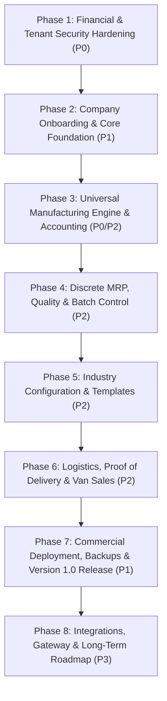

# Common ERP – Phased Multi-Industry Development Plan

This document establishes the realistic, dependency-ordered engineering execution plan to transition Common ERP into a commercially viable, production-grade multi-industry platform.

---

## 1. Dependency-Ordered Phase Progression

Rather than developing features arbitrarily, the phases strictly follow structural architectural dependencies:

---

## 2. Detailed Phase Specifications

---

### Phase 1: Financial Integrity & Tenant Security Hardening
- **Objective**: Fix the critical financial disconnects and establish bulletproof database-level tenant isolation.
- **Priority**: **`P0 – CRITICAL RELEASE BLOCKER`**
- **Existing Functionality Reused**: `AccountingService`, `AccountsController`, `ReportController`, `CompanyContextService`.
- **Missing Functionality**:
  1. Dynamic injection of Net Profit from P&L into Balance Sheet Equity.
  2. Indirect-method Cash Flow Statement.
  3. Stock Adjustment and Opening Stock accounting journal postings.
  4. Global Eloquent `TenantScope` trait applied to all 66 tenant models.
- **Dependencies**: None. Can begin immediately.
- **Database Impact**: Add index on `journal_lines.ledger_id`; no schema changes needed.
- **Files Affected**:
  - `app/Http/Controllers/ReportController.php` (`balanceSheet`, `cashFlow`)
  - `app/Http/Controllers/InventoryController.php` (`adjustmentStore`, `openingStockStore`)
  - `app/Models/Scopes/TenantScope.php` (New)
  - `app/Traits/BelongsToTenant.php` (New)
- **Required Automated Tests**:
  - `BalanceSheetReconciliationTest`: Asserts Assets strictly equals Liabilities + Equity across periods with Net Profit.
  - `CashFlowStatementTest`: Asserts net cash change matches Bank/Cash ledger delta.
  - `GlobalTenantScopeSecurityTest`: Tests raw `Item::all()` and `Customer::all()` to assert zero cross-tenant leakage.
- **Completion Criteria**: Balance Sheet balances dynamically; Trial Balance, P&L, and Cash Flow reconcile; all tenant models enforce `TenantScope`.

---

### Phase 2: Company Onboarding & Foundation Usability
- **Objective**: Enable a non-technical business owner to set up a new company, seed accounts, and start transacting without developer intervention.
- **Priority**: **`P1 – ESSENTIAL COMMON ERP`**
- **Existing Functionality Reused**: `CompanyController`, `SettingsController`, `MasterDataController`, `CompanyAccountsSeeder`.
- **Missing Functionality**:
  1. Auto-seeding of standard 44 chart of accounts ledgers upon company creation.
  2. First-time setup wizard (`/setup`) for initial administrator installation.
  3. Module activation and menu toggle UI screen (`/settings/modules`).
  4. Universal Excel/CSV data export on master listings and transactional grids.
- **Dependencies**: Phase 1 (requires stable financial ledgers).
- **Database Impact**: None.
- **Files Affected**:
  - `app/Http/Controllers/CompanyController.php` (`store`)
  - `app/Http/Controllers/SetupWizardController.php` (New)
  - `app/Http/Controllers/SettingsController.php` (`modules`, `modulesUpdate`)
  - `resources/views/settings/modules.blade.php` (New)
- **Required Automated Tests**:
  - `CompanyOnboardingFlowTest`: Creates a new company via UI and asserts 44 ledgers, 1 admin user, and 1 financial year exist automatically.
- **Completion Criteria**: Non-developer can install and configure a new trading company via browser in under 5 minutes.

---

### Phase 3: Universal Manufacturing Engine & Cost Capitalization
- **Objective**: Connect factory production to the general ledger, capitalizing raw material consumption and worker labor into finished goods inventory.
- **Priority**: **`P0 / P1 – CRITICAL OPERATIONAL CORE`**
- **Existing Functionality Reused**: `DailyOperationService`, `DailyOperationController`, `InventoryService`, `AccountingService`.
- **Missing Functionality**:
  1. Automated double-entry journal posting upon operation completion: Debit Finished Goods Asset, Credit Raw Materials Inventory Asset, Credit Wages/Labor Payable.
  2. Operational cost rollup: unit finished good cost = (total raw materials consumed + total piece-rate wages + allocated machine cost) / produced output quantity.
- **Dependencies**: Phase 1 (Accounting Service hardening).
- **Database Impact**: Add `journal_entry_id` column to `daily_operations` table.
- **Files Affected**:
  - `app/Services/DailyOperationService.php` (`postOperationStock`)
  - `app/Http/Controllers/DailyOperationController.php` (`complete`)
- **Required Automated Tests**:
  - `ManufacturingAccountingCapitalizationTest`: Completes a daily operation and asserts inventory stock balances, ledger balances, and debits == credits on the resulting capitalization JV.
- **Completion Criteria**: Physical stock movements and general ledger inventory asset accounts reconcile perfectly after batch production.

---

### Phase 4: Discrete MRP, Quality Control & Batch Management
- **Objective**: Implement traditional Bill of Materials (BOM), planned production orders, and quality inspection quarantine gates.
- **Priority**: **`P2 – MULTI-INDUSTRY CAPABILITY`**
- **Existing Functionality Reused**: MySQL tables `boms`, `bom_items`, `production_orders`, `quality_checks`.
- **Missing Functionality**:
  1. `BomController` and interactive multi-level BOM creation UI.
  2. `ProductionOrderController` and work order tracking (`draft` -> `released` -> `in_progress` -> `completed`).
  3. `QualityCheckController` with inspection parameters (Standard vs Observed values, Pass/Fail).
  4. Quarantine inventory status: inward goods cannot be sold or consumed until QC approval.
- **Dependencies**: Phase 3 (Manufacturing core).
- **Database Impact**: Minor enhancements to existing `quality_checks` and `production_orders` tables.
- **Files Affected**:
  - `app/Http/Controllers/BomController.php` (New)
  - `app/Http/Controllers/ProductionOrderController.php` (New)
  - `app/Http/Controllers/QualityCheckController.php` (New)
  - `resources/views/manufacturing/*` (New views)
- **Required Automated Tests**:
  - `DiscreteManufacturingWorkflowTest`: Creates BOM, issues Production Order, records material consumption, executes QC check, and asserts finished goods stock inward.
- **Completion Criteria**: Discrete manufacturing companies (engineering, furniture, machinery) can operate using standard BOMs and work orders.

---

### Phase 5: Industry Configuration Engine & Vertical Templates
- **Objective**: Provide declarative vertical configuration templates that dynamically customize UI forms, navigation menus, and attributes per industry.
- **Priority**: **`P2 – MULTI-INDUSTRY CAPABILITY`**
- **Existing Functionality Reused**: `industry_process_templates` table.
- **Missing Functionality**:
  1. Dynamic entity attribute engine (e.g. Size/Color for apparel, FSSAI/Allergens for food, Hallmark/HUID for jewellery).
  2. Apparel 2D Size x Color variant generator creating child SKU permutations.
  3. Vertical templates for 6 core industries: Food, Garments, Beverages, Supermarkets, Hardware Retail, and Engineering.
- **Dependencies**: Phase 2 (Module toggle) and Phase 4 (Manufacturing).
- **Database Impact**: Create `entity_attributes` and `item_variants` tables.
- **Files Affected**:
  - `app/Services/ConfigurationService.php` (New)
  - `app/Http/Controllers/MasterDataController.php` (`productStore`, `productUpdate`)
- **Required Automated Tests**:
  - `IndustryTemplateSwitchingTest`: Switches company from Food to Garments; asserts that FSSAI fields hide and Size/Color variant generator becomes active.
- **Completion Criteria**: Single codebase presents tailored UI screens based on the active company's configured industry template.

---

### Phase 6: Logistics, Proof of Delivery (POD) & Retail Resiliency
- **Objective**: Enhance delivery route logistics with mobile driver verification and harden retail point of sale.
- **Priority**: **`P2 – LOGISTICS & RETAIL`**
- **Existing Functionality Reused**: `SalesController` (POS and Deliveries), `MasterDataController` (Routes/Vehicles).
- **Missing Functionality**:
  1. Mobile driver Proof of Delivery (POD) screen: customer signature capture pad and delivery photo upload.
  2. Dynamic UPI QR code generation on counter POS receipts and sales invoice PDFs.
  3. Returnable packaging / crate deposit tracking for beverage and bottling distributors.
- **Dependencies**: Phase 2 (Sales & Logistics foundation).
- **Database Impact**: Create `sales_delivery_proofs` and `returnable_package_balances` tables.
- **Files Affected**:
  - `app/Http/Controllers/SalesController.php` (`podStore`, `pos`)
  - `resources/views/sales/pod.blade.php` (New mobile view)
- **Required Automated Tests**:
  - `ProofOfDeliveryWorkflowTest`: Dispatches trip, uploads driver signature, asserts status updates to `delivered`.
- **Completion Criteria**: Complete delivery visibility from dispatch to digital customer sign-off.

---

### Phase 7: Commercial Deployment Tooling & Version 1.0 Release
- **Objective**: Package the application for automated, reliable managed deployments across paying commercial clients.
- **Priority**: **`P1 – COMMERCIAL RELEASE GATE`**
- **Existing Functionality Reused**: All modules from Phases 1–6.
- **Missing Functionality**:
  1. Automated nightly database backup engine (`spatie/laravel-backup`) with admin download UI and S3 retention.
  2. Standardized Docker Compose container stack for 1-click customer instance provisioning.
  3. End-user PDF manuals and administrator operations documentation.
- **Dependencies**: Phases 1 through 6.
- **Database Impact**: None.
- **Completion Criteria**: **OFFICIAL COMMERCIAL VERSION 1.0 RELEASE.** Ready for paying enterprise deployment.

---

### Phase 8: Long-Term Roadmap & Version 2.0 (Post-Release)
- **Objective**: Expand commercial footprint through payment gateways, messaging APIs, mobile apps, and SaaS billing.
- **Priority**: **`P3 – STRATEGIC EXPANSION`**
- **Scope**:
  - Razorpay / Stripe payment gateway SDK integration.
  - WhatsApp Business Cloud API automated invoice alerts.
  - Indian Government GST E-Way Bill and E-Invoice NIC portal connector.
  - Offline-resilient POS caching using browser IndexedDB.
  - External REST API gateway with Laravel Sanctum tokens.
  - Self-service multi-tenant SaaS billing with Stripe subscriptions.
