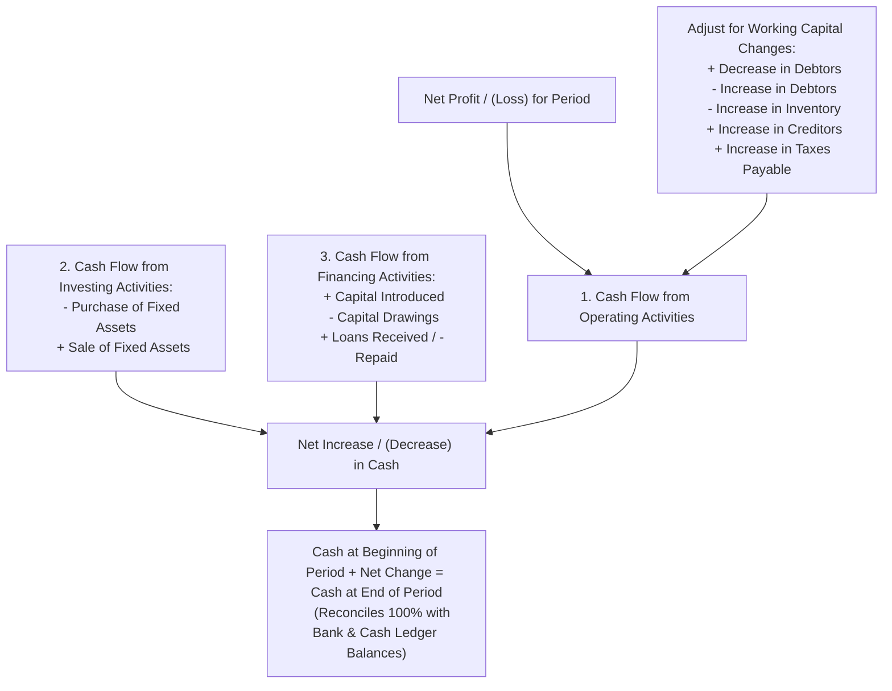

# Common ERP – Phase 4 Accounting Design: Double-Entry Specifications

This document defines the formal double-entry accounting specifications for all Phase 4 financial integrity corrections.

---

## 1. Chart of Accounts Mapping & Standard Ledgers

All transactions in Phase 4 map to standard system ledgers resolved via `AccountingService::getOrCreateStandardLedger()`. If the ledger or its parent group does not exist for the tenant company, it is provisioned automatically with the correct `nature` and `balance_type`.

| Ledger Name | Group Code & Name | Group Nature | Normal Balance | Purpose in Phase 4 |
| :--- | :--- | :--- | :---: | :--- |
| **Stock on Hand** | `CA-01 Current Assets` | `Assets` | `debit` | Primary inventory asset account representing total physical merchandise and trading goods. |
| **Raw Materials Inventory** | `CA-01 Current Assets` | `Assets` | `debit` | Factory inventory asset representing unconsumed raw ingredients, fabrics, or parts. |
| **Work in Progress (WIP)** | `CA-01 Current Assets` | `Assets` | `debit` | Clearing asset accumulating raw materials, direct labor, and overheads during production. |
| **Finished Goods Inventory** | `CA-01 Current Assets` | `Assets` | `debit` | Asset account representing completed manufactured goods ready for distribution or sale. |
| **Opening Balance Equity** | `EQ-01 Capital & Reserves` | `Equity` | `credit` | Balancing equity account for initial opening stock and asset/liability onboarding. |
| **Inventory Shortage & Loss** | `EXP-01 Direct Expenses` | `Expenses` | `debit` | Expense recognizing physical inventory deficits discovered during physical counts. |
| **Inventory Surplus & Gain** | `REV-01 Sales & Operating Revenue` | `Revenue` | `credit` | Operating revenue recognizing physical inventory surpluses discovered during counts. |
| **Damaged & Expired Stock Expense** | `EXP-01 Direct Expenses` | `Expenses` | `debit` | Loss recognizing spoiled, expired, or physically damaged goods written off from stock. |
| **Manufacturing Labor Payable** | `CL-01 Current Liabilities` | `Liabilities` | `credit` | Accrued liability for piece-rate and daily wages earned by factory workers. |
| **Production Scrap & Wastage** | `EXP-01 Direct Expenses` | `Expenses` | `debit` | Expense capturing abnormal factory scrap and production rejections. |

---

## 2. Double-Entry Voucher Specifications

---

### A. Opening Stock Journal Voucher
- **Voucher Type**: `'Opening Balance'`
- **Trigger**: Execution of `InventoryController@openingStockStore`.
- **Validation**:
  - Total Opening Value: $V = \sum (\text{item.quantity} \times \text{item.unit\_cost})$.
  - If $V > 0$, post balanced voucher:

$$\begin{array}{llr}
\textbf{Account} & \textbf{Classification} & \textbf{Amount} \\
\hline
\text{Dr. Stock on Hand} & \text{Assets} & \$V \\
\text{Cr. Opening Balance Equity} & \text{Equity} & \$V \\
\end{array}$$

- **Traceability**: `reference_type = 'OpeningStock'`, `reference_id = $godownId`, `reference_no = 'OPENING-YYYYMMDD'`.

---

### B. Stock Adjustment Journal Vouchers
- **Voucher Type**: `'Stock Adjustment'`
- **Trigger**: Execution of `InventoryController@adjustmentStore`.
- **Valuation**: $\text{Adjustment Value } V = | \text{Actual Stock} - \text{Current Stock} | \times \text{Cost Price}$.

#### Case 1: Shortage / Shrinkage ($\text{Actual} < \text{Current}$)
$$\begin{array}{llr}
\textbf{Account} & \textbf{Classification} & \textbf{Amount} \\
\hline
\text{Dr. Inventory Shortage \& Loss} & \text{Expenses} & \$V \\
\text{Cr. Stock on Hand} & \text{Assets} & \$V \\
\end{array}$$

#### Case 2: Surplus / Physical Found ($\text{Actual} > \text{Current}$)
$$\begin{array}{llr}
\textbf{Account} & \textbf{Classification} & \textbf{Amount} \\
\hline
\text{Dr. Stock on Hand} & \text{Assets} & \$V \\
\text{Cr. Inventory Surplus \& Gain} & \text{Revenue} & \$V \\
\end{array}$$

#### Case 3: Damaged / Expired Stock ($\text{Reason contains 'damage' or 'expire'}$)
$$\begin{array}{llr}
\textbf{Account} & \textbf{Classification} & \textbf{Amount} \\
\hline
\text{Dr. Damaged \& Expired Stock Expense} & \text{Expenses} & \$V \\
\text{Cr. Stock on Hand} & \text{Assets} & \$V \\
\end{array}$$

- **Traceability**: `reference_type = 'StockAdjustment'`, `reference_id = $adj->id`, `reference_no = $adj->adjustment_no`.

---

### C. Manufacturing Operations Journal Voucher
- **Voucher Type**: `'Manufacturing'`
- **Trigger**: Execution of `DailyOperationService@postOperationStock` on operation completion.
- **Cost Accumulation**:
  - Consumed Raw Materials Value: $M = \sum (\text{consumed\_qty} \times \text{unit\_cost})$
  - Direct Labor Wages: $L = \sum \text{employee wage earned}$
  - Abnormal Scrap / Wastage: $W = \text{total wastage cost}$
  - Finished Goods Capitalized: $F = (M + L) - W$

$$\begin{array}{llr}
\textbf{Account} & \textbf{Classification} & \textbf{Amount} \\
\hline
\text{Dr. Finished Goods Inventory} & \text{Assets} & \$F \\
\text{Dr. Production Scrap \& Wastage} & \text{Expenses (if } W > 0) & \$W \\
\text{Cr. Raw Materials Inventory / Stock on Hand} & \text{Assets} & \$M \\
\text{Cr. Manufacturing Labor Payable} & \text{Liabilities} & \$L \\
\end{array}$$

$$\text{Total Debits} = F + W = (M + L - W) + W = M + L = \text{Total Credits} \quad \mathbf{[BALANCED]}$$

- **Traceability**: `reference_type = 'DailyOperation'`, `reference_id = $op->id`, `reference_no = $op->operation_number`.

---

## 3. Financial Statements Design & Reconciliation

### A. Balance Sheet Equation Reconciliation
The Balance Sheet must satisfy:
$$\text{Total Assets} = \text{Total Liabilities} + \text{Total Equity} + \text{Current Period Net Profit}$$

If Net Profit has not yet been closed into Retained Earnings via a fiscal year closing entry:
1. `ReportController@balanceSheet` calculates:
   $$\text{Net Profit} = \sum \text{Revenue Ledgers} - \sum \text{Expense Ledgers}$$
2. Injects a virtual line item under the Equity section:
   - `Current Period Net Profit / (Loss)` = `+$netProfit`
3. $\text{Total Liabilities and Equity} = \text{Liabilities} + \text{Equity} + \text{Net Profit}$.
4. Mathematically guarantees that **Assets == Liabilities + Equity** for any chosen date range.

### B. Indirect Cash Flow Statement Architecture
`ReportController@cashFlow` calculates:

