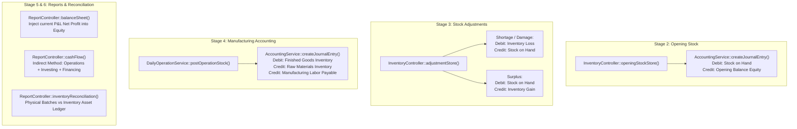

# Common ERP – Phase 4 Current Implementation Audit: Financial & Inventory Integrity

This document delivers the comprehensive Stage 1 technical inspection of the current financial, inventory, and manufacturing implementations in Common ERP before any Phase 4 code modifications.

---

## 1. Accounting Domain Inspection

### A. Core Accounting Service (`app/Services/AccountingService.php`)
- **Method `createJournalEntry()`**:
  - Accepts `$companyId`, `$branchId`, `$voucherType`, `$voucherDate`, `$narration`, `$lines`, `$referenceType`, `$referenceId`, `$referenceNo`.
  - Enforces double-entry balance: $| \sum \text{Debits} - \sum \text{Credits} | \le 0.05$. Throws `\Exception` on imbalance.
  - Automatically locates and validates open `FinancialYear` for the given `$voucherDate`.
  - Generates voucher sequence number formatted as `TYPE-YYYY-XXXXX`.
  - Atomically writes `JournalEntry` and `JournalLine` records within a database transaction.
  - Triggers `$ledger->recalculateBalance()` for each affected ledger.
- **Method `updateJournalEntry()`**:
  - Updates voucher header, deletes old lines, recreates new lines, and recalculates balances for all previously and newly affected ledgers.
- **Method `getOrCreateStandardLedger()`**:
  - Dynamically resolves or creates standard system ledgers (e.g. `Stock on Hand`, `Purchase Account`, `GST Input Tax Credit`) under the appropriate `AccountGroup` and `nature` (`Assets`, `Liabilities`, `Equity`, `Revenue`, `Expenses`).

### B. Chart of Accounts & General Ledger Models
- **`AccountGroup` (`app/Models/AccountGroup.php`)**:
  - Hierarchical structure with `parent_id`.
  - Stores `nature`: `Assets`, `Liabilities`, `Equity`, `Revenue`, `Expenses`.
- **`Ledger` (`app/Models/Ledger.php`)**:
  - Belongs to `Company` and `AccountGroup`.
  - Tracks `opening_balance`, `balance_type` (`debit` / `credit`), and running `current_balance`.
  - Method `recalculateBalance()` dynamically computes:
    $$\text{Balance} = \text{Opening Balance} + (\sum \text{Debits} - \sum \text{Credits})$$
    (Inverted for Credit nature: Liabilities, Equity, Revenue).

### C. Financial Reporting (`app/Http/Controllers/ReportController.php`)
- **`trialBalance()`**: Recalculates balances on the fly and displays all non-zero ledgers. Accurately verifies $\sum \text{Debits} = \sum \text{Credits}$.
- **`profitAndLoss()`**: Aggregates Revenue ledgers and Expense ledgers to compute Net Profit = Revenue minus Expenses.
- **`balanceSheet()`**:
  - **Identified Defect**: Sums Asset ledgers and Liabilities/Equity ledgers, but **omits current-period Net Profit from P&L**. Assets do not balance with Liabilities + Equity unless a manual closing entry has been posted.
- **`cashFlow()`**:
  - **Identified Defect**: **Completely missing from routes, controllers, and views.**

---

## 2. Inventory Domain Inspection

### A. Core Inventory Service (`app/Services/InventoryService.php`)
- **Method `recordInward()`**:
  - Locates or creates `StockBatch` matching `(godown_id, item_id, batch_no)`.
  - Increments `batch->quantity` and updates `batch->cost_price`.
  - Logs an immutable `StockMovement` row with `movement_type = 'inward'`.
- **Method `recordOutward()`**:
  - Employs database row locking (`lockForUpdate()`) on `StockBatch`.
  - Enforces strict negative stock prevention: throws `\RuntimeException` if `available < requested`.
  - Decrements `batch->quantity` and logs `StockMovement` with `movement_type = 'outward'`.
- **Method `adjustStock()`**:
  - Modifies batch quantity to match physical count.
  - Logs `StockMovement` with `movement_type = 'adjustment_in'` or `'adjustment_out'`.

### B. Inventory Controller (`app/Http/Controllers/InventoryController.php`)
- **Method `openingStockStore()`**:
  - Validates `godown_id` and array of `items.*.item_id`, `quantity`, `unit_cost`.
  - Calls `InventoryService::recordInward()` for each item.
  - **Identified Defect**: **Posts zero accounting journal entries.** Stock on hand increases physically, but Inventory Asset and Opening Balance Equity ledgers are not updated.
- **Method `adjustmentStore()`**:
  - Validates `godown_id`, `item_id`, `actual_stock`, `reason`.
  - Updates `StockBatch` and creates `StockAdjustment` + `StockAdjustmentItem`.
  - **Identified Defect**: **Posts zero accounting journal entries.** Physical shortages, surpluses, and damages are not reflected in the general ledger.

---

## 3. Manufacturing Domain Inspection

### A. Daily Operation Service (`app/Services/DailyOperationService.php`)
- **Method `createOperation()`**:
  - Calculates `$totalLaborCost` from employee piece-rate or hourly wages.
  - Calculates `$totalMaterialCost` from consumed raw materials.
  - Stores header and child relationships (`daily_operation_materials`, `daily_operation_employees`, `daily_operation_outputs`, `daily_operation_wastages`, `daily_operation_distributions`).
- **Method `postOperationStock()`**:
  - Deducts raw materials via `InventoryService::recordOutward()`.
  - Inwards produced finished goods via `InventoryService::recordInward()`.
  - Initiates branch distribution `StockTransfer` records.
  - **CRITICAL DEFECT**: **Does not import `AccountingService` and posts ZERO journal entries.**
  - Consumed raw materials are not credited from inventory assets.
  - Worker wages are not credited to labor liabilities.
  - Finished goods are not capitalized into inventory assets.

---

## 4. Existing Database Structures

| Table Name | Primary Keys & Scopes | Critical Columns for Phase 4 |
| :--- | :--- | :--- |
| `companies` | `id` | Tenant root |
| `branches` | `id`, `company_id` | Facility boundary |
| `financial_years` | `id`, `company_id` | `start_date`, `end_date`, `is_closed` |
| `account_groups` | `id`, `company_id` | `code`, `name`, `nature`, `parent_id` |
| `ledgers` | `id`, `company_id` | `code`, `name`, `account_group_id`, `current_balance`, `balance_type` |
| `journal_entries` | `id`, `company_id` | `voucher_no`, `voucher_type`, `voucher_date`, `reference_type`, `reference_id`, `reference_no`, `total_debit`, `total_credit` |
| `journal_lines` | `id`, `journal_entry_id` | `ledger_id`, `debit_amount`, `credit_amount`, `narration` |
| `godowns` | `id`, `company_id` | Warehouse identifier |
| `items` | `id`, `company_id` | Product master, `purchase_price`, `selling_price` |
| `stock_batches` | `id`, `company_id` | `godown_id`, `item_id`, `batch_no`, `quantity`, `cost_price` |
| `stock_movements` | `id`, `company_id` | `godown_id`, `item_id`, `batch_id`, `movement_type`, `quantity`, `balance_after` |
| `stock_adjustments` | `id`, `company_id` | `adjustment_no`, `adjustment_date`, `godown_id`, `reason`, `status` |
| `daily_operations` | `id`, `company_id` | `operation_number`, `operation_date`, `stock_posted`, `total_labor_cost`, `total_material_cost`, `total_wastage_cost` |

---

## 5. Proposed Modifications & Implementation Blueprint

### Database Impact & Backward Compatibility
- **Database Safety**: We will create a non-destructive migration `2024_01_04_000001_add_journal_entry_id_to_daily_operations_and_stock_adjustments.php` adding nullable foreign key `journal_entry_id` to `daily_operations` and `stock_adjustments`.
- **Zero Regression**: Existing transactions in `purchase_entries`, `sales_invoices`, and `payrolls` remain untouched.
- **Idempotency**: All new journal postings check for existing references to prevent double-posting.
