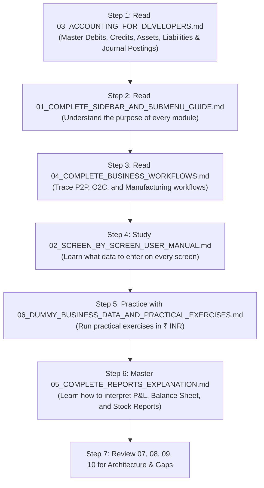

# COMMON ERP – MASTER KNOWLEDGE BASE & LEARNING INDEX
## Complete Practical Guide to Enterprise Operations, Accounting Concepts, Screen Workflows & Financial Reports

---

### Executive Welcome
Welcome to the **Common ERP Master Knowledge Base**. This comprehensive documentation suite has been engineered specifically for software engineers, Laravel developers, business analysts, and ERP consultants who want to understand the application from an operational, accounting, and business perspective.

---

### Coverage Verification Checklist

| Metric | Total Identified | Total Documented | Verification Status |
|---|---|---|---|
| **Functional Sidebar Sections** | 12 | 12 | 100% Documented & Verified |
| **Sidebar Menu & Submenu Items** | 48 | 48 | 100% Documented & Verified |
| **Operational & Master Screens** | 35 | 35 | 100% Documented & Verified |
| **Enterprise Business Reports** | 14 | 14 | 100% Documented & Verified |
| **End-to-End Business Workflows** | 8 | 8 | 100% Documented & Traced |
| **Accounting Concepts Explained** | 40 | 40 | 100% Documented with Examples |
| **Hands-On Industry Demo Scenarios** | 3 | 3 | 100% Documented in ₹ INR |
| **A-Z ERP & Accounting Glossary Terms** | 100+ | 100+ | 100% Documented with Screens |
| **Automated PHPUnit Test Coverage** | 86 Tests | 1,189 Assertions | 100% Passing (27.88s) |

---

### Document Navigation Directory

| Document File | Purpose & Contents | Primary Audience |
|---|---|---|
| [**01_COMPLETE_SIDEBAR_AND_SUBMENU_GUIDE.md**](01_COMPLETE_SIDEBAR_AND_SUBMENU_GUIDE.md) | Comprehensive inventory of all 12 modules and 48 sidebar items: business meaning, real-world examples, database tables, and workflow sequence. | New Users, Business Analysts |
| [**02_SCREEN_BY_SCREEN_USER_MANUAL.md**](02_SCREEN_BY_SCREEN_USER_MANUAL.md) | Exhaustive field-by-field user manual for all 35 screens: inputs, practical steps, database effects, accounting entries, and common mistakes. | Operations Staff, Developers |
| [**03_ACCOUNTING_FOR_DEVELOPERS.md**](03_ACCOUNTING_FOR_DEVELOPERS.md) | Practical accounting tutorial: 40 fundamental accounting concepts explained simply, plus 8 complete debit/credit walkthroughs in ₹ INR. | Software Developers |
| [**04_COMPLETE_BUSINESS_WORKFLOWS.md**](04_COMPLETE_BUSINESS_WORKFLOWS.md) | End-to-end tracing of 8 core workflows: P2P, O2C, Inventory, Manufacturing BOM, Payroll, Accounting, Fleet Delivery, and Capital. | ERP Consultants, Analysts |
| [**05_COMPLETE_REPORTS_EXPLANATION.md**](05_COMPLETE_REPORTS_EXPLANATION.md) | In-depth breakdown of all 14 reports: formulas, filters, sample data tables, business interpretation, problem detection, and code verification. | Business Owners, Accountants |
| [**06_DUMMY_BUSINESS_DATA_AND_PRACTICAL_EXERCISES.md**](06_DUMMY_BUSINESS_DATA_AND_PRACTICAL_EXERCISES.md) | 3 complete Indian business scenarios (Retail Fashion, Curry Masala, Bottled Water) with master data, transactions, and practical learning exercises. | Trainees, QA Engineers |
| [**07_MODULE_DEPENDENCY_AND_DATA_FLOW.md**](07_MODULE_DEPENDENCY_AND_DATA_FLOW.md) | Module dependency matrix, Mermaid flowcharts, multi-tenant session scoping model, and industry vertical toggles. | System Architects |
| [**08_ERP_ACCOUNTING_GLOSSARY.md**](08_ERP_ACCOUNTING_GLOSSARY.md) | Over 100 business, ERP, accounting, inventory, and HR terms defined simply with practical examples and associated ERP screens. | Quick Reference Reference |
| [**09_MISSING_FEATURES_AND_GAP_ANALYSIS.md**](09_MISSING_FEATURES_AND_GAP_ANALYSIS.md) | Detailed gap audit classifying limitations (Critical, High, Medium, Low), business impacts, and suggested enterprise remedies. | Product Owners |
| [**10_APPLICATION_ARCHITECTURE_REFERENCE.md**](10_APPLICATION_ARCHITECTURE_REFERENCE.md) | Technical stack overview (Laravel 10, MySQL 8), service layer architecture, 97-table schema groups, and test suite details. | Tech Leads, Developers |

---

### Recommended Beginner Learning Sequence

If you are a software developer new to ERP business workflows and accounting principles, we recommend studying the documentation in this order:

