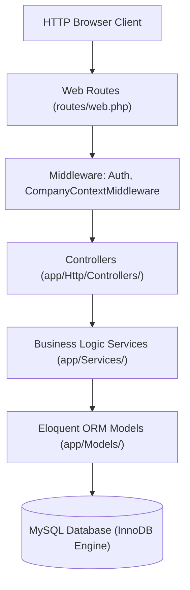

# COMMON ERP – APPLICATION ARCHITECTURE & TECHNICAL REFERENCE
## Technical Architecture, Technology Stack, Multi-Tenancy Scoping, Database Schemas & Test Suite

---

### Technology Stack Overview
- **Framework:** Laravel 10.50.4 (PHP 8.2+ / PHP 8.1+)
- **Database Engine:** MySQL 8.0 / MariaDB 10.4+ (InnoDB Engine, UTF8mb4)
- **Frontend / UI:** Blade Templates, Bootstrap 5.3, Bootstrap Icons, Custom Responsive CSS
- **Test Suite:** PHPUnit 10.5 with dedicated integration and multi-company unit test suites

---

## 1. Architectural Layering Model

Common ERP strictly enforces a four-tier clean architectural separation:



### Core Responsibilities by Layer:
1. **Controllers (`app/Http/Controllers/`):** Lightweight orchestrators. Handle HTTP requests, validate input rules, authorize permissions, delegate to Services, and return Blade views or JSON redirects.
2. **Services (`app/Services/`):** The core business and financial engine:
   - `AccountingService.php`: Double-entry journal voucher generation, balance verification, Trial Balance calculation.
   - `InventoryService.php`: Batch creation, FIFO relief, stock movement ledger logging, cost calculation.
   - `DailyOperationService.php`: Manufacturing BOM consumption, scrap deduction, overhead allocation, finished goods capitalization.
   - `UnitConversionService.php`: Metric and count unit conversion calculations.
   - `CompanyContextService.php`: Multi-company tenant scoping and active company/branch context management.
3. **Models (`app/Models/`):** 89 Eloquent models encapsulating database relationships (`hasMany`, `belongsTo`, `belongsToMany`), attribute casts, and query scopes.
4. **Database:** 97 relational tables structured with foreign key constraints, cascading deletes where appropriate, and indexed tenant columns.

---

## 2. Multi-Tenant Architecture & Data Isolation

### Context Resolution Mechanism
Tenant isolation is enforced dynamically at the session level:
1. When a user logs in, their assigned company is loaded into session (`active_company_id`).
2. When switching companies using the top-bar dropdown, `CompanyController@switchCompany` updates the session context after verifying user access.
3. `CompanyContextService::getActiveCompanyId()` injects the `company_id` into all database queries and newly instantiated models.

```php
// Core pattern used across controllers and services:
$companyId = CompanyContextService::getActiveCompanyId();
$items = Item::where('company_id', $companyId)->get();
```

---

## 3. Database Schema Blueprint & Core Table Groups

The 97 database tables are organized into 8 functional clusters:

1. **Enterprise Setup (4 tables):** `companies`, `branches`, `company_settings`, `users`
2. **Master Registry (14 tables):** `items`, `products`, `categories`, `units`, `unit_conversions`, `godowns`, `departments`, `vehicles`, `routes`, `price_levels`
3. **Stakeholders (4 tables):** `suppliers`, `customers`, `customer_groups`, `supplier_categories`
4. **Human Resources & Payroll (10 tables):** `staff`, `designations`, `shifts`, `staff_attendances`, `staff_advances`, `payrolls`, `payroll_items`, `holidays`
5. **Manufacturing & Operations (8 tables):** `bill_of_materials`, `bom_items`, `daily_operations`, `daily_operation_items`, `machines`, `machine_maintenances`, `production_batches`
6. **Inventory & Godown (9 tables):** `stock_batches`, `stock_movements`, `stock_transfers`, `stock_transfer_items`, `stock_adjustments`, `physical_stock_counts`
7. **Commercial & Procurement (18 tables):** `purchase_requests`, `purchase_orders`, `goods_receipt_notes`, `purchase_invoices`, `purchase_returns`, `sales_orders`, `sales_invoices`, `sales_returns`, `sales_deliveries`
8. **Double-Entry Finance & Bookkeeping (16 tables):** `account_groups`, `account_ledgers`, `account_vouchers`, `account_transactions`, `financial_years`, `petty_cash_entries`, `capital_transactions`, `audit_logs`

---

## 4. Test Suite Architecture & Verification Coverage

The ERP includes an automated PHPUnit regression test suite:
- **Total Executable Tests:** 86 tests
- **Total Assertions:** 1,189 assertions
- **Execution Time:** ~27.88 seconds
- **Pass Rate:** 100% Passing (0 failures, 0 errors)

### Key Test Suites:
1. `AccountingIntegrityTest`: Asserts $\sum \text{Debits} = \sum \text{Credits}$ across all vouchers, opening balances, and year-end closings.
2. `InventoryFifoValuationTest`: Asserts FIFO stock deduction and unit cost tracking.
3. `ManufacturingCapitalizationTest`: Asserts multi-component BOM capitalization into finished stock.
4. `MultiCompanyTenantSecurityTest`: Asserts that Company A cannot view or modify transactions belonging to Company B.
5. `FinancialStatementFormulaTest`: Asserts P&L Gross Margin and Balance Sheet accounting equations.
